# Topic 1.1: Interface and Cable Issues

**Official exam topic (v2.0):** Diagnose interface and cable (copper and fiber) issues such as collisions, errors, mismatched duplex, speed, distance, interface, signal levels, pin out, and cable types.

**Status:** Done (lesson, lab, notes) | **Date:** 4 Oct 2026 | **Level:** E (can explain), C (can configure). T (can troubleshoot) is being tested again later.

> **How these notes were made:** I study with an AI study coach (Claude, made by Anthropic). The coach explained the topic, tested me, checked my lab, and wrote the first draft of these notes. I did the lab myself in Packet Tracer, answered the questions in my own words, and the mistake log shows my real mistakes. I read and edit the notes before I publish them.
> The goal: even if I forget everything, I can read them from top to bottom and understand topic 1.1 again.
> They are **not** exam dumps. They contain **no real exam questions**. The practice questions were written by my study coach.
> Packet Tracer is a simulator. Where it behaves differently from a real switch, I say so.
> Diagrams marked `mermaid` draw themselves on GitHub and in Obsidian. If one does not draw, the same idea is also written as text.

## Contents (click a line to jump to it)

- [0. Must memorize (the short version)](#0-must-memorize-the-short-version)
- [Part 1: Duplex](#part-1-duplex)
- [Part 2: Speed and auto-negotiation](#part-2-speed-and-auto-negotiation)
- [Part 3: Error counters](#part-3-error-counters)
- [Part 4: Copper cables, distance, pin out](#part-4-copper-cables-distance-pin-out)
- [Part 5: Fiber, SFP, and signal levels](#part-5-fiber-sfp-and-signal-levels)
- [Part 6: Reading show interfaces](#part-6-reading-show-interfaces)
- [7. Commands (all in one place)](#7-commands-all-in-one-place)
- [8. Exam angle](#8-exam-angle) and [9. Job angle](#9-job-angle)
- **[10. My lab (Cisco Packet Tracer)](#10-my-lab-cisco-packet-tracer)**
  - [Lab part 1: Baseline](#part-1-baseline)
  - [Lab part 2: Manual on one side only](#part-2-manual-on-one-side-only)
  - [Lab part 3: Force a real duplex mismatch](#part-3-force-a-real-duplex-mismatch)
  - [Lab part 4: Fix (best way)](#part-4-fix-best-way)
  - [Lab part 5: Shut a port](#part-5-shut-a-port)
  - [What I learned about Packet Tracer](#what-i-learned-about-packet-tracer-differences-from-a-real-switch)
- [11. Self-test (own words)](#11-self-test-own-words)
- [12. My mistake log](#12-my-mistake-log)
- [13. Word list](#13-word-list)
- [14. Sources checked](#14-sources-checked)

## How to read these notes

1. Read **0. Must memorize** first. It is the short version.
2. Then read Parts 1 to 6 in order. Each part has: the problem, the idea, a comparison, how it works, an example, a common mistake, and a quick check.
3. Then read the **lab**, the **self-test**, and the **mistake log**.
4. The **word list** at the end explains every technical word.

---

# 0. Must memorize (the short version)

**Duplex and speed**
- Full duplex = no collisions. Half duplex = collisions possible.
- Duplex mismatch: the port stays **up/up**, but the link is slow and full of errors.
- Speed mismatch: the link usually goes **down**.
- Best practice: both ends **auto**, or both ends **manual and equal**. Never one manual and one auto.
- Cisco gigabit (1000 Mbps) is **full duplex only**.
- In `show interfaces status`: `a-full` / `a-100` = the value came from **auto**. No `a-` = **typed by hand**. Plain `auto` = no link yet, only the setting.

**Error counters**
- **Half side** of a mismatch: **collisions, late collisions** (and FCS/alignment errors).
- **Full side** of a mismatch: **runts, CRC**, and 0 collisions.
- Frame size: **64 to 1518 bytes**. Runt = smaller (with a bad check). Giant = bigger (with a bad check).
- Counters are **cumulative**. Save the old numbers, run `clear counters`, wait 5 to 10 minutes, look again. Rising = live fault.

**Copper**
- Max **100 m** per segment (the signal gets weaker: attenuation).
- 10/100 Mbps uses **2 pairs**. 1000BASE-T uses **4 pairs**.
- MDI (PC, router): send on pins **1,2**, receive on **3,6**. MDIX (switch, hub): send on **3,6**, receive on **1,2**.
- Same kind of port = **crossover**. Different kind = **straight-through**.
- Gigabit crossover also swaps pins 4,5 and 7,8.
- Auto-MDIX fixes the cable type by itself. It needs speed and duplex on **auto**. Command: `mdix auto`.

**Fiber**
- Single-mode = thin core, laser, goes far. Multimode = wider core, shorter distance.
- 1000BASE-SX: 850 nm, multimode only, up to about 550 m (50 micrometer fiber).
- 1000BASE-LX/LH: 1310 nm, up to 10 km on single-mode. 1000BASE-EX: 40 km. 1000BASE-ZX: about 70 km.
- LX/LH light power: transmit -3 to -9.5 dBm, receive -3 to -20 dBm. SX: transmit -4 to -9.5 dBm, receive 0 to -17 dBm. (Cisco SFP data sheet. Other SFP types have other ranges.)
- dBm: **closer to zero = stronger**. Too weak and too strong are both bad.
- Both ends use the **same SFP type**.

**Status words**
- `up/up` = Layers 1 and 2 work (still check duplex and errors).
- `administratively down` or `disabled` = someone typed `shutdown`. Fix: `no shutdown`.
- `notconnect` = no signal. Check cable, plugs, other end, SFP type, length.
- `err-disabled` = the switch shut the port by itself. Find the reason first (`show logging`), then `shutdown` and `no shutdown`.

**Commands**
- `interface fastEthernet 0/1`, then `speed 100`, `duplex full`, `speed auto`, `duplex auto`, `shutdown`, `no shutdown`.
- `show interfaces status`, `show interfaces <port>`, `show interfaces <port> transceiver detail`, `clear counters <port>`.
- **Interface commands work only in `(config-if)#`.**

**Memory hooks**
- "Half side shouts collisions. Full side cries runts."
- "Enter the port, then flip the switch."
- "Closer to zero is stronger."
- "Same kind of port = crossover."

---

# Part 1: Duplex

## 1.1 The problem

Two devices share a wire. If both talk at the same moment, the data gets mixed up and destroyed.

## 1.2 The idea in one sentence

**Duplex** means: can this link send and receive at the same time (full), or only one at a time (half)?

## 1.3 Real-life comparison: two kinds of road

```
FULL DUPLEX = a road with 2 lanes
  Car -->  ------------------------>  (lane 1)
  Car <--  <------------------------  (lane 2)
  Both directions at the same time. No crash.

HALF DUPLEX = a narrow bridge with 1 lane
  Car -->  ======== one lane ======== <-- Car
  Only one direction at a time. If two cars enter together: CRASH.
```

**Where it breaks:** on a bridge, a crash destroys the cars. In networking, a "crash" is a **collision**. The data is lost, both devices wait a random short time, then send again. Nobody is hurt, but it is slow.

## 1.4 How it works

**Half duplex** (old way: hubs, a shared cable):
1. Listen: is the wire free?
2. If it is free, send.
3. If a collision happens, stop, wait a random time, and send again.

This listen-first rule has a name: **CSMA/CD** (Carrier Sense Multiple Access with Collision Detection).

**Full duplex** (normal today: a switch port connected to one device):
- Send and receive use **different wire pairs** inside the cable.
- Nobody shares a lane, so **collisions cannot happen**.
- The listen-first step is switched off.

```
Full duplex cable (10/100 Mbps):
  PC  TX pair ===============> RX pair  Switch
  PC  RX pair <=============== TX pair  Switch
```

**Gigabit copper (1000BASE-T)** uses all **4 pairs**. Each pair carries data in both directions at the same time. The network card separates the two signals. The result is the same: full duplex, no collisions. (My road comparison breaks a little here: a real lane carries one direction only.)

**Cisco gigabit is full duplex only.** The IEEE standard also allows half duplex at gigabit, but Cisco devices support only full.

## 1.5 Real example

```
Full-duplex, 1000Mb/s
0 collisions
```

- `Full-duplex` = the two-lane road.
- `0 collisions` = it must always be 0 on full duplex. A collision count on a full-duplex port is a warning sign.

## 1.6 Common mistake

People think half duplex only means slower speed. The truth: half duplex also brings **collisions**, and **only half duplex has collisions**.

## 1.7 Quick check (with answers)

- Why can a full-duplex link never have collisions? **Because send and receive use different wire pairs, so nobody shares a lane.**
- A half-duplex port can listen while it sends. Why? **Only to catch a crash. It still cannot send and receive data at the same time.**

---

# Part 2: Speed and auto-negotiation

## 2.1 The problem

Ports can run at 10, 100, or 1000 Mbps, in half or full duplex. Two connected ports must use the **same** settings. Who decides?

## 2.2 The idea in one sentence

**Auto-negotiation**: both ports tell each other what they can do, then pick the best setting they both support.

## 2.3 Real-life comparison: two people choosing a language

Ahmad speaks Urdu, Punjabi, and English. A friend speaks Urdu and English. They tell each other what they know and pick the best language both know: Urdu.

**Where it breaks:** people can ask questions again and again. Ports send a short signal only, and the talk is very fast.

## 2.4 How it works

```
Both ports on AUTO:
  SW A: "I can do 10, 100, 1000. Half and full."
  SW B: "I can do 10, 100. Half and full."
  Both pick the best common setting: 100 Mbps, full duplex.
```

### The tricky case: manual on one side, auto on the other

```
SW A: speed 100, duplex full   (manual: A does NOT negotiate)
SW B: auto

B listens to A's signal:
  - Speed?  B can measure it from the signal itself -> 100
  - Duplex? A sends no duplex message, so B cannot learn it.
            On 10/100 links B usually falls back to HALF duplex.

Result: A = full, B = half -> DUPLEX MISMATCH
```

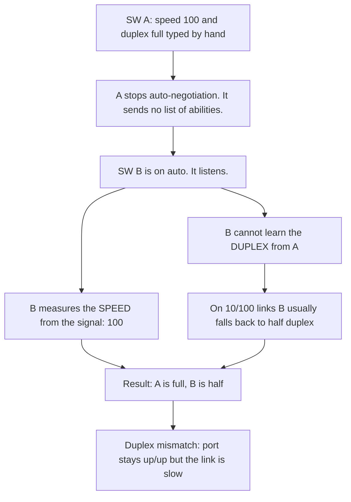

### Why can A not send a message?

Auto ports send small signals at the start of the link. Inside them is a list of abilities. When you type `speed 100` and `duplex full`, you turn auto-negotiation **off** on that port. It then sends only a plain signal and no list. It is not broken. It is following your command. (Comparison: a person wearing a "do not talk" sign. You can see them and hear them breathe, which is the speed, but they will not tell you their language, which is the duplex.) B can still measure the speed from the signal. This is called **parallel detection**.

### Why does B choose half, and why is half not "safe"?

B has no information about the duplex, so the standard fixes one default: half. Half is the oldest mode (hubs and old devices only knew half), so it matches the most devices. But it is **not a safe choice**. If B guessed full and A was half, you would get the same mismatch the other way round.

```
B has no information about A's duplex:
  guess HALF -> works if A is half. Mismatch if A is full.   (our case)
  guess FULL -> works if A is full. Mismatch if A is half.
```

So the rule is a **default**, not a safe choice. "Usually half" is the common result, not a fixed law. Cisco's tech note says a port cannot detect the duplex when the other side is not on auto.

## 2.5 What happens when the settings do not match

| Mismatch | What happens |
|---|---|
| **Speed** mismatch (for example 10 vs 100) | The link usually goes **down**. Easy to see. |
| **Duplex** mismatch | The link is **up/up**, but slow and full of errors. Hard to find. |

Cisco's tech note calls a duplex mismatch one of the most common causes of performance problems on 10/100 links.

**Best practice:**
- Both sides **auto**, or
- Both sides **manual with the same settings**.
- Never one manual and one auto.

If you hard-code the speed on a Cisco port, auto-negotiation is turned off for both speed and duplex on that port.

## 2.6 Commands

```
SW1(config)# interface gigabitEthernet 0/1
SW1(config-if)# speed 100
SW1(config-if)# duplex full
```

- `speed 100` = set 100 Mbps by hand. `duplex full` = set full duplex by hand.
- To go back to auto: `speed auto` and `duplex auto`.
- On some switches you must set the speed before the duplex.

## 2.7 Reading the `a-` prefix (the autofill picture)

On your phone some form boxes are autofilled and some you type by hand. The switch table works the same way:

```
Gi0/1 in the baseline:     a-full   a-100    <- filled by auto (the "a-" is the mark)
Gi0/1 after you typed:     full     100      <- typed by hand (no mark)
Gi0/2 with no cable:       auto     auto     <- empty box, only the setting
```

- When a port is **connected**, the columns show what the port **is using now**. If the value came from auto it has `a-`.
- Plain `auto` shows when there is **no link** to learn from.
- `a-` does **not** prove the other side agrees. In a mismatch the auto side can still show `a-half`. Read **both** sides.

```
SW1# show interfaces status
Port   Name  Status       Vlan  Duplex  Speed  Type
Gi0/1        connected    20    a-full  a-1000 10/100/1000BaseTX
Gi0/2        notconnect   20    auto    auto   10/100/1000BaseTX
Gi0/3        disabled     20    auto    auto   10/100/1000BaseTX
Gi0/4        err-disabled 20    auto    auto   10/100/1000BaseTX
Gi0/5        connected    20    half    100    10/100/1000BaseTX
```

(Example written by me.) Gi0/5 is half duplex at 100 with no `a-`, so someone typed it. It looks suspicious, but you must read the other side before you call it a fault.

## 2.8 Common mistake

People think any mismatch brings the link down. The truth: a **speed** mismatch usually does, but a **duplex** mismatch keeps the link up and slow.

## 2.9 Quick check (with answers)

- SW A is `speed 100` and `duplex full` by hand. SW B is on auto. What does B end up with, and what do users feel? **Usually half duplex. The link is up/up but slow.**
- Why does SW2 show `a-full` and not `auto` when it is connected? **Because it is on auto and is showing the value it is using, with the a- mark.**

---

# Part 3: Error counters

## 3.1 The problem

A link is up/up but slow. You need a quick way to see **what kind** of trouble it has.

## 3.2 The idea in one sentence

Each counter in `show interfaces` counts one kind of damaged or lost frame. The **kind** points to the cause.

## 3.3 Real-life comparison: parcels at a post office

- A **frame** is one parcel. It has a size rule and a sealed label (the check number).
- **Runt** = a parcel smaller than allowed.
- **Giant** = a parcel bigger than allowed.
- **CRC error** = the parcel arrived, but the seal check failed. It was damaged on the way.
- **Collision** = two parcels pushed through the same door at the same moment.

**Where it breaks:** a post office would complain about damaged parcels. A switch silently drops the bad frame and adds 1 to a counter. Nobody complains, so **you** must read the counter.

## 3.4 How it works

```
Frame sizes (normal Ethernet):
  smaller than 64 bytes + bad CRC   = RUNT
  64 to 1518 bytes + good CRC       = healthy frame
  bigger than 1518 bytes + bad CRC  = GIANT
```

The sender calculates a number from the data and puts it at the end of the frame. That box is the **FCS** (Frame Check Sequence). The calculation is the **CRC** (Cyclic Redundancy Check). The receiver calculates again. Same number = good frame. Different number = damaged frame, drop it, count one CRC error.

- **CRC** = the method (a math check). **FCS** = the field that holds the result.

| Counter | Usual cause |
|---|---|
| collisions | Normal on half duplex. A problem on full duplex. |
| late collisions | Duplex mismatch (seen on the **half** side), or a cable that is too long |
| CRC / FCS errors | Bad cable, bad port, bad NIC, noise, **or a duplex mismatch** |
| runts | Duplex mismatch (seen on the **full** side), or a bad cable, port, or NIC |
| giants | Often a bad NIC |
| alignment errors | Frame does not end on a whole byte, with a bad check. Seen on the half side of a mismatch with FCS errors |

A **late collision** is a collision that happens after the first 64 bytes (512 bit-times) of a frame have been sent. Normal collisions happen at the very start.

## 3.5 A mismatch seen from both sides

```
HALF side: collisions, LATE collisions, FCS/alignment errors
FULL side: runts and CRC errors, 0 collisions
```

Why the two sides look different:
1. The full side sends **any time** and never waits.
2. The half side listens while it sends. It is already sending, so the full side's frame arrives as a collision. It is a **late** one, because the full side does not wait for its turn. Two half-duplex devices both check "is the line free?" first, so a crash can happen only in a tiny moment at the start (early collisions).
3. The half side stops sending when it sees the crash. The full side receives these cut-short frames: **runts** with a bad CRC.

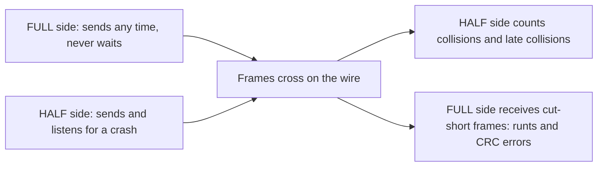

Example (my own practice output), 15 minutes after `clear counters`:

```
SW1# show interfaces gigabitEthernet 0/3
  Full-duplex, 100Mb/s
  600 input errors, 600 CRC, 450 runts
  0 collisions, 0 late collision
SW1# show interfaces status
Gi0/3   connected   20   full    100

SW2# show interfaces gigabitEthernet 0/3
  Half-duplex, 100Mb/s
  0 input errors, 0 CRC
  3000 collisions, 450 late collision
SW2# show interfaces status
Gi0/3   connected   20   a-half   a-100
```

- Problem: duplex mismatch. Clues: full vs half, runts and CRC with 0 collisions on SW1, collisions and late collisions on SW2.
- SW1 was set **by hand** (`full 100`, no `a-`). SW2 was on **auto** (`a-half a-100`).
- Best fix: on SW1 type `speed auto` and `duplex auto`. (Setting SW2 to `speed 100` and `duplex full` also works, but then both sides are manual, and Cisco says auto-MDIX needs auto.)

## 3.6 Counters are cumulative

- Counters keep adding up from the last time they were cleared (or since the switch started).
- A big number may be **old**. A small number may be **new and rising**.
- `clear counters <port>` sets them to zero. **Write down the old numbers first**, because clearing deletes the evidence. Then wait 5 to 10 minutes and look again. If a number rises, the fault is **live**.
- A few clean minutes do not prove the link is healthy forever. Some faults come and go (a loose plug, a motor that starts at certain times). Check again later, for example in the busy hour.

```
GigabitEthernet0/4 is up, line protocol is up
  Full-duplex, 1000Mb/s
  Last clearing of "show interface" counters never
  38 input errors, 38 CRC, 0 runts, 0 giants
  0 collisions
```

Switch running 11 months, users say it is fine: **38 CRC in 11 months is almost nothing.** 38 CRC in the last 5 minutes would be a real fault. The **rate** matters, not the number.

## 3.7 The puzzle: full duplex, CRC errors, 0 collisions, settings match

```
Clue 1: 5000 CRC errors  -> frames arrive DAMAGED
Clue 2: 0 collisions     -> no two-cars-on-one-bridge problem
Clue 3: full duplex      -> collisions cannot happen anyway
Clue 4: speed and duplex match on both sides -> NOT a duplex mismatch
```

Only one place is left: the **path between the two ports** (cable, plugs, noise, port, NIC).

| Order | Check | Why |
|---|---|---|
| 1 | Read **both** sides: duplex and speed | Cheap. Rules out a mismatch. |
| 2 | **Re-seat** the cable (unplug it and push it back firmly) | A loose plug is the easiest fault. |
| 3 | **Replace the cable** with a known good one | A damaged cable is the most common cause. |
| 4 | Look for **noise** (motors, power cables) and check the length | Noise damages the signal. |
| 5 | Try another **port** or another **NIC** | The port or NIC can be bad. |

## 3.8 Common mistake

People think **CRC always means a bad cable**. The truth: CRC can also come from a duplex mismatch. Check duplex on **both sides** first. It is cheap and it avoids replacing a good cable.

## 3.9 Quick check (with answers)

- Why does the half side see **late** collisions? **The full side never waits for its turn, so its frame can crash in after the half side has already sent a lot of its frame.**
- Full duplex port, matching settings, CRC rising: where does the damage come from? **The path: cable, plugs, noise, port, or NIC.**

---

# Part 4: Copper cables, distance, pin out

## 4.1 The problem

A copper cable carries data as small electrical signals. The longer the cable, the weaker the signal. If it gets too weak, the other side cannot read it. Also, the cable has 8 wires, and the two ends must connect so that what one side sends, the other side hears.

## 4.2 Distance: why 100 meters

**The idea:** copper loses strength over distance (**attenuation**), so Ethernet copper (100BASE-TX and 1000BASE-T) has a maximum of **100 meters** for one segment.

Real-life comparison: your voice across a field. At 10 m your friend hears you clearly. At 150 m he hears only noise. **Where it breaks:** a switch cannot shout louder, but a switch in the middle **rebuilds a fresh strong copy** of the signal.

```
Signal strength along one cable:

Strong |■■■■■■■■■■
       |■■■■■■■■
       |■■■■■■          <- 100 m: still readable
       |■■■■
Weak   |■■              <- 150 m: too weak, noise wins
       +----------------------------------> distance
```

Two enemies work together: (1) attenuation makes the signal weaker, (2) noise (interference) hurts a weak signal more.

Example: a PC on a **150 m** cable. The switch log may repeat:

```
%LINK-3-UPDOWN: Interface GigabitEthernet0/1, changed state to down
%LINK-3-UPDOWN: Interface GigabitEthernet0/1, changed state to up
```

The link keeps dropping and coming back. This is **flapping**. The port may also stay `notconnect`, or show CRC errors while up.

**Fixes:**
- Put a **switch in the middle** (each piece under 100 m). A plain cable joiner does not help, because it only joins two weak signals.
- Use **fiber** for the long part.

**Common mistake:** a cable that is too long does not usually make the link "a little slower". Past the limit you usually get **errors or a flapping link**.

## 4.3 Pin out: which wire is send and which is receive

**Pin** = one small metal contact inside the plug. The plug (RJ-45) has 8 pins, numbered 1 to 8.

- **MDI**: sends on pins **1,2** and receives on pins **3,6**. PCs, laptops, and routers are MDI.
- **MDIX**: the opposite. Sends on **3,6** and receives on **1,2**. Switches and hubs are MDIX.
- **Straight-through cable**: pin 1 to pin 1, pin 2 to pin 2, and so on.
- **Crossover cable**: pins 1,2 are swapped with pins 3,6.

Real-life comparison: two people talking. Your mouth must point at the other person's ear. Mouth to mouth, nobody hears. **Where it breaks:** a person has a fixed mouth and ear. In a cable, "mouth" and "ear" are just wire pairs, and the cable can swap them.

```
PC (MDI) to Switch (MDIX), STRAIGHT cable:

  PC                              Switch
  pins 1,2  TX  ------------->  pins 1,2  RX   OK: mouth to ear
  pins 3,6  RX  <-------------  pins 3,6  TX   OK: ear to mouth

PC to PC, STRAIGHT cable (wrong):

  PC 1                            PC 2
  pins 1,2  TX  ------------->  pins 1,2  TX   mouth to mouth. Nobody hears.

PC to PC, CROSSOVER cable:

  PC 1                            PC 2
  pins 1,2  TX  ----\  /---->   pins 3,6  RX   OK
  pins 3,6  RX  <---/  \-----   pins 1,2  TX   OK
```

**Simple rule:**

```
Different kind of port (MDI <-> MDIX)  -> STRAIGHT-through
Same kind of port      (MDI <-> MDI)   -> CROSSOVER
                       (MDIX <-> MDIX) -> CROSSOVER
```

| Connection (without auto-MDIX) | Cable |
|---|---|
| PC to switch | Straight-through |
| Router to switch | Straight-through |
| Switch to switch | Crossover |
| PC to PC | Crossover |
| Router to router | Crossover |
| **Router to PC** | **Crossover** |

**Common mistake:** "Router and PC are different devices, so straight-through." The truth: both are **MDI**, so a router to PC link needs a **crossover** (without auto-MDIX). Think "same kind of port", not "different device name".

Gigabit copper uses all **4 pairs**. A gigabit crossover also swaps the other two pairs (pins 4,5 and 7,8). Only the 10/100 rule above is the important one to memorize.

```
10/100 Mbps copper (uses 2 pairs):
  Pair on pins 1,2 = SEND only     ------>
  Pair on pins 3,6 = RECEIVE only  <------
1000 Mbps copper (1000BASE-T, uses all 4 pairs):
  Every pair sends AND receives at the same time.
```

## 4.4 Auto-MDIX

Modern ports have **auto-MDIX**: the port detects the cable and fixes the pins itself. So today a straight-through cable usually works for switch to switch.

- Command: `mdix auto` (interface mode).
- Enabled by default on Catalyst 2960 and 3560. Not on the older 2950 and 3550.
- **Important:** for auto-MDIX to work correctly, the interface **speed and duplex must be on auto**. If someone hard-codes them, auto-MDIX may stop working, and a straight-through cable between two switches can fail (link down).

## 4.5 Quick check (with answers)

- A PC is on a 150 m cable and the port flaps. Why, and two fixes? **The signal gets weaker over distance and noise makes it worse. Put a switch in the middle, or use fiber.**
- Without auto-MDIX, why does PC to PC need crossover? **Both are MDI and both send on pins 1,2, so send would meet send. A crossover swaps the pairs so one side's send reaches the other side's receive.**
- Could `speed 100` and `duplex full` typed on an auto-MDIX port cause trouble with a straight cable between two switches? **Yes. Auto-MDIX needs speed and duplex on auto, so it may stop working and the link can fail.**

---

# Part 5: Fiber, SFP, and signal levels

## 5.1 The problem

Copper stops at 100 m, and noise from motors and power cables can damage the signal. A building, a campus, or a city needs longer links with no noise problem.

## 5.2 The idea in one sentence

**Fiber** sends data as **pulses of light** through a thin glass strand, so it goes much farther than copper and electrical noise cannot touch it.

Real-life comparison: torch flashes at night. Copper is like shouting across a field (wind spoils it). Fiber is like torch flashes (wind does not change the light). **Where it breaks:** a torch can be blocked by fog. Fiber has its own enemies: a dirty connector, a sharp bend, or a broken glass strand.

## 5.3 How it works

```
Fiber cross-section:

   [ cladding (glass wall)                   ]
   [   [ core (thin glass: the light path) ] ]
   [ cladding                                ]

Light stays inside the core, because the cladding reflects it back.
```

One link uses **two strands**:

```
Switch A                              Switch B
  TX ----------- strand 1 ---------->  RX
  RX <---------- strand 2 -----------  TX
```

- One strand sends, one receives. There is no crossover problem like copper, but if TX meets TX the link stays **down**. Swap the two strands at one end.

### Two types of fiber

```
SINGLE-MODE:  very thin core, laser light
  ===============================================>
  Light goes almost straight. Travels very far.

MULTIMODE:  wider core, LED-type light
  /\/\/\/\/\/\/\/\/\/\/\/\/\/\/\/\/\/\/\/\/\/\/\/>
  Light bounces in many paths. Blurs over long distance.
```

| | Single-mode | Multimode |
|---|---|---|
| Core size | very thin | wider |
| Light source | laser | LED-type (or similar) |
| Typical wavelength | 1310 nm (and others) | 850 nm |
| Distance | long (many kilometers) | shorter (hundreds of meters) |
| Cost | optics cost more | optics cost less |
| Typical use | between buildings, long links | inside a building or data center |

**Light does not lose "nothing".** Fiber also weakens the light (attenuation), just much less than copper. Dirty connectors and bends weaken it too.

## 5.4 SFP: the plug-in module

**SFP = Small Form-factor Pluggable.** A small module that you push into a slot on a switch.

- **Problem:** different links need different media (copper, short fiber, long fiber). Fixed ports would force a different switch for every case, and a longer distance would mean a new switch.
- **Idea:** an SFP is a plug-in adapter that turns the slot into the exact kind of port you need.
- **Comparison:** the SIM card in a phone. Same phone, new SIM. Same switch, new SFP. **Where it breaks:** a SIM is chosen by the phone company. An SFP is chosen by **cable type and distance**, and both ends must match. An SFP also contains a real light transmitter and receiver.

```
 Switch front
 +--------------------------------------------+
 | [RJ-45 port] [RJ-45 port]  [ SFP slot ]    |
 +--------------------------------------------+
                                  |
                  push in an SFP:
                  +-----------------+
                  |  SX  (850 nm)   | -> multimode, short
                  |  LX/LH (1310nm) | -> single-mode, 10 km
                  |  EX  / ZX       | -> 40 km / about 70 km
                  |  1000BASE-T     | -> copper RJ-45 inside the SFP
                  +-----------------+
```

**Reasons for SFP slots:**
1. **Flexibility:** copper, short fiber, or long fiber, chosen per port.
2. **Change later, spend little:** a longer distance needs a new module, not a new switch.
3. **Pay only for what you need:** a short link does not need an expensive long-range module.

**Common mistake:** "An SFP is the cable." No. The SFP is the **module in the switch**. The fiber cable is a separate thing that plugs into the SFP.

### SFP types (Cisco Gigabit SFP data sheet)

| SFP type | Fiber | Maximum distance |
|---|---|---|
| 1000BASE-SX | multimode only | up to 550 m on 50 micrometer, up to 220 m on 62.5 micrometer |
| 1000BASE-LX/LH | single-mode (and multimode) | up to 10 km on single-mode, up to 550 m on multimode |
| 1000BASE-EX | single-mode | up to 40 km |
| 1000BASE-ZX | single-mode | about 70 km |

- Fiber SFPs use LC connectors (two strands).
- There is also a copper SFP, 1000BASE-T, which supports 10/100/1000 auto-negotiation and auto-MDIX.

### Both ends must match

Both ends must use the **same SFP standard** (SX with SX, LX with LX), and the fiber must suit that SFP. The LX/LH SFP also works on multimode, but Cisco says on older multimode fiber it should go through a **mode conditioning patch cable** (a special cable that adjusts the light).

```
SW1: 1000BASE-SX SFP (850 nm)     SW2: 1000BASE-LX/LH SFP (1310 nm)     Cable: single-mode, 3 km
```

This link cannot work for three reasons: (1) different SFP types (850 nm vs 1310 nm), (2) SX is multimode only but the cable is single-mode, (3) 3 km is more than SX can do (about 550 m). Smallest fix: change SW1's SX to **LX/LH**. Then check Tx and Rx, clean the connectors, and check the port is up/up.

**Scaling example:** a switch has an SFP slot. Today it links a room 300 m away (SX, multimode). Next year the other switch moves 8 km away. Change the SX SFP to LX/LH at **both ends** and use **single-mode** fiber. That is far cheaper than a new switch.

## 5.5 Signal levels

- **Tx power** = the light the SFP sends. **Rx power** = the light that arrives.
- Unit: **dBm**. 0 dBm = 1 milliwatt. A negative number is less than 1 milliwatt. **Closer to zero = stronger.**

```
 0 dBm  = 1 milliwatt                 strongest of these
-3 dBm  = about half of 1 mW
-10 dBm = one tenth of 1 mW
-20 dBm = one hundredth of 1 mW       weaker
```

So -8 dBm is stronger than -15 dBm.

Comparison: water pressure in a pipe. Tap pressure = Tx. Pressure at the end = Rx. The pipe must deliver enough pressure, but too much can also hurt the end device. **Where it breaks:** pressure drops smoothly. In fiber the loss adds up in steps (each dirty connector, each bend, each meter).

```
Switch A (Tx)                                      Switch B (Rx)
SFP sends light ---- fiber, connectors, bends ----> SFP receives light
   Tx = -7 dBm        (some light is lost here)       Rx = -9 dBm

  Rx must stay inside the allowed range of the SFP.
  Too low  = link drops or errors   (the usual problem)
  Too high = also bad               (the receiver is overloaded)
```

| SFP | Transmit (dBm) | Receive range (dBm) |
|---|---|---|
| 1000BASE-SX | -4 to -9.5 | 0 to -17 |
| 1000BASE-LX/LH | -3 to -9.5 | -3 to -20 |

(Read from the Cisco SFP data sheet: first pair transmit, second pair receive. Other SFP types have other ranges. Check the data sheet for your exact SFP.)

### The command: DOM

```
SW1# show interfaces gigabitEthernet 0/1 transceiver detail
```

- **DOM** (Digital Optical Monitoring) is a feature of some SFPs. They report their own transmit power, receive power, temperature, voltage, and laser bias current, with thresholds for each.
- Marks in the output: `++` high alarm, `+` high warning, `-` low warning, `--` low alarm.
- It works only with DOM-capable SFPs and not on every platform. Some devices answer that the module does not support DOM.

Practice reads (my own examples), SFP is 1000BASE-LX/LH:

```
Transmit power:  -5.0 dBm
Receive power:  -26.0 dBm  (--)
```

Rx -26 is below the -20 limit, so it is **too weak**. The `(--)` mark is a low alarm. Local Tx (-5.0) is inside -3 to -9.5, so **my own SFP is fine**. The weak light comes from the path or from the far end's transmit. Check **both ends**.

```
Transmit power:  -4.0 dBm
Receive power:   -2.0 dBm
```

Tx is fine. Rx -2.0 is **stronger than the top of the range (-3)**, so it is **too strong**. Both too weak and too strong are out of range.

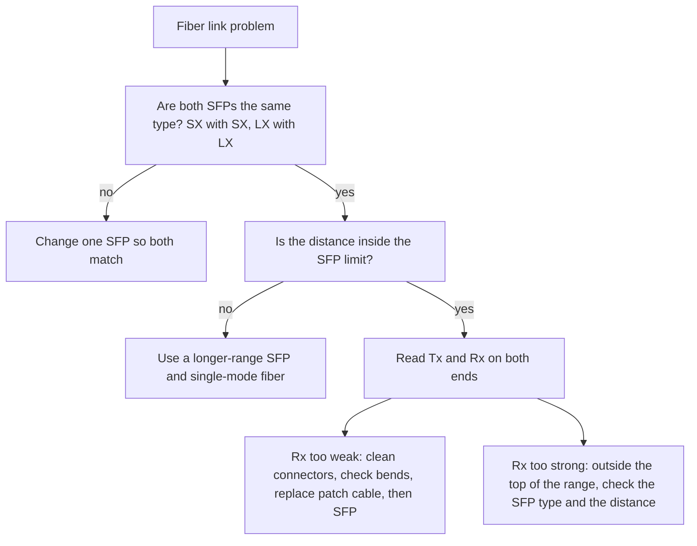

**If Rx is weak** (my own order, not a Cisco rule): clean the connectors (dust is a very common cause), check for a sharp bend, check the distance, check both SFPs match, replace the patch cable, then the SFP.

**Common mistake:** "No errors on the port means the fiber is fine." The light level can be weak or too strong **before** any error appears. Reading Rx and Tx early is the whole point of DOM.

I could not find a Cisco page that says how deep the exam goes on signal levels. Learn the basics above and do not spend days on it.

## 5.6 Quick check (with answers)

- Two switches 2 km apart: copper or fiber? **Fiber. Copper is limited to 100 m.** Which type? **Single-mode with an LX/LH-class SFP (up to 10 km). SX multimode does only about 550 m.**
- What is an SFP and why do switches have SFP slots? **A small plug-in module. It lets one switch use copper, short fiber, or long fiber per port. To change the distance you change the module, not the switch.**
- Why is "no errors" not enough for a fiber link? **Light can be too weak or too strong before errors start.**

---

# Part 6: Reading `show interfaces`

## 6.1 The problem

A user says "the network is dead". You have a command line and about one minute. If you read the output in the wrong order, you waste time on the wrong thing.

## 6.2 The idea in one sentence

**Read the first line first.** It tells you if the problem is the cable and signal, something higher up, or a port that someone shut.

Comparison: a phone call that does not work. (1) Is the phone switched off? (2) Is there no signal? (3) Is there signal, but the call fails? **Where it breaks:** a phone has one status. A port shows **two** statuses on the first line.

## 6.3 The first line

```
GigabitEthernet0/1 is up, line protocol is up
                    |                |
                    |                +-- 2nd word: LINE PROTOCOL
                    |                    the switch says the link is usable (Layer 2: frames work)
                    |
                    +-- 1st word: the cable and signal are there (Layer 1: physical)
```

- **Layer 1 (physical layer)** = the cable, the plugs, and the signal.
- **Layer 2 (data link layer)** = frames moving between two devices on the same link.
- **Line protocol** = the switch's own check that the link is usable at Layer 2.

| First line shows | What it means | First thing to check |
|---|---|---|
| `is administratively down, line protocol is down` | Someone typed `shutdown` | Type `no shutdown` on the port |
| `is down, line protocol is down (notconnect)` | No signal. Layer 1 problem | Cable plugged in? Other end powered on? Cable and SFP type OK? Cable too long? |
| `is down, line protocol is down (err-disabled)` | The switch shut the port to protect itself | Find out **why** first (read the log: `show logging`). Then fix. |
| `is up, line protocol is up` | Layer 1 and 2 work | Not "fine" yet. Check duplex and errors |
| `is up, line protocol is down` | Signal is there but Layer 2 is not working | Not common on switch ports. More often seen on routers |

In `show interfaces status` the same states appear as `connected`, `notconnect`, `disabled` (shutdown) and `err-disabled`.

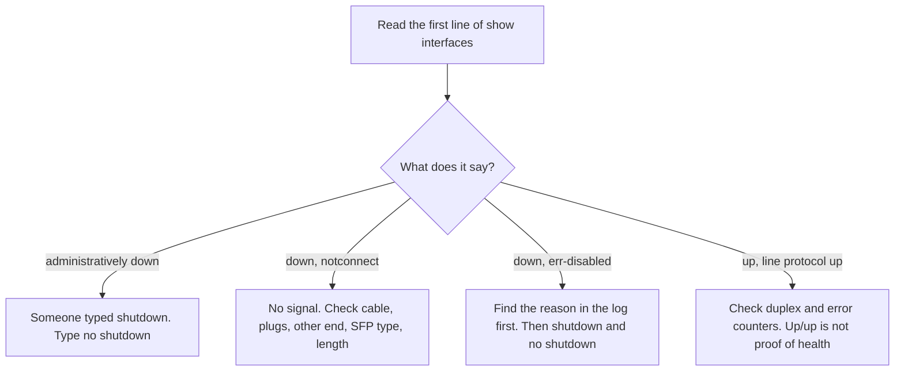

**Common mistake:** "up/up means everything is fine." A duplex mismatch is up/up but slow and full of errors.

## 6.4 The 4-step reading order

```
Step 1  First line         up/up? down? administratively down? notconnect?
Step 2  Speed and duplex   half or full? does it match the other side?
Step 3  Input errors       CRC, runts, giants  -> bad cable, noise, or mismatch (full side)
Step 4  Output side        collisions, late collisions -> half duplex or mismatch (half side)
```

Always ask: is this number **growing** or **old**? (See counters are cumulative, Part 3.)

Comparison: a doctor. First: is the patient awake (status line)? Then pulse and temperature (speed and duplex). Then test results (counters). One high number from last year is not an emergency. A number that rises every minute is.

## 6.5 A healthy output

```
SW1# show interfaces gigabitEthernet 0/1
GigabitEthernet0/1 is up, line protocol is up (connected)   <- Layer 1 and 2 work
  Full-duplex, 100Mb/s                                      <- duplex and speed in use
  Last clearing of "show interface" counters never          <- counters are cumulative
  0 runts, 0 giants                                         <- frame sizes OK
  0 input errors, 0 CRC                                     <- no damaged frames
  0 collisions, 0 late collision                            <- no collision problems
```

## 6.6 A ticket: "Users on floor 3 say the network is slow since this morning"

Floor 3 connects to SW1 on `GigabitEthernet0/12` with copper. You can log in to SW1 only. Slow means the port is probably up, so shutdown and unplugged checks do not fit.

1. `show interfaces gigabitEthernet 0/12` and `show interfaces status`. Read the status line, speed, duplex, and the `a-` prefix.
2. Read the counters. CRC and runts with 0 collisions on a full-duplex port = the full side of a mismatch, or a bad cable. Collisions or late collisions = this side is half duplex.
3. Save the old numbers. `clear counters gigabitEthernet 0/12`. Wait 5 to 10 minutes. Look again. Rising = live fault.
4. Mismatch or manual-versus-auto found: put both ends on auto (or both manual and equal). Do the far side when you get access.
5. Duplex matches but CRC rises: re-seat and replace the cable, check the length (max 100 m), look for noise, try another port.

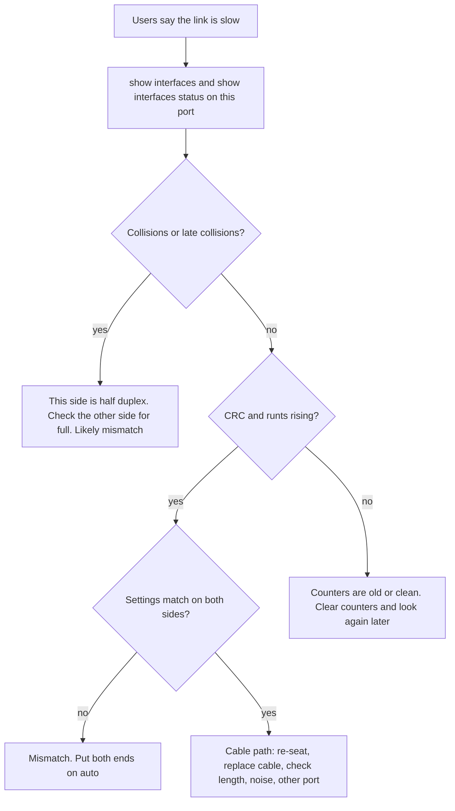

A common mistake for a new person: blaming the cable before reading duplex and counters on both sides, or reading old counters as if they were new.

---

# 7. Commands (all in one place)

**Configuration (interface mode):**

```
SW1> enable
SW1# configure terminal
SW1(config)# interface fastEthernet 0/1
SW1(config-if)# speed 100
SW1(config-if)# duplex full
SW1(config-if)# speed auto
SW1(config-if)# duplex auto
SW1(config-if)# mdix auto
SW1(config-if)# shutdown
SW1(config-if)# no shutdown
SW1(config-if)# end
SW1#
```

**Modes (rooms in a building):**

```
SW1>                   street
SW1#                   lobby          (enable takes you here)
SW1(config)#           office floor   (configure terminal takes you here)
SW1(config-if)#        one room: the port
```

`no shutdown` is a switch **inside the room** for that port. If you stand on the office floor you cannot flip the switch of a room you have not entered. `end` goes straight back to the lobby. `exit` goes back one level. Write `no shutdown` in full in notes. Short forms like `sh` can be ambiguous.

Inside config mode you can run a show command with `do`, for example `do show interfaces status`.

**Show and clear (privileged mode):**

```
SW1# show interfaces status
SW1# show interfaces gigabitEthernet 0/1
SW1# show interfaces gigabitEthernet 0/1 transceiver detail
SW1# show running-config
SW1# show logging
SW1# clear counters gigabitEthernet 0/1
```

- `transceiver detail` shows the light levels and works only with DOM SFPs. The plain `show interfaces` shows the counters, not the light levels.
- A command that does not appear in the running config did not take effect. Check the config after you configure.

---

# 8. Exam angle

- Cisco may show a `show interfaces` output or a status table and ask for the most likely cause or the first action.
- Watch the wording: "since this morning", "after replacing the cable", "both sides". They tell you if a counter is old or new, and what is already ruled out.
- Match the clue to the cause: collisions / late collisions = half duplex. CRC and runts with 0 collisions = full side of a mismatch. CRC only with matching settings = cable path.
- Read the `a-` prefix: no `a-` means typed by hand.
- Interface commands must be in interface mode. The exam checks the mode too.
- I do not know the exact exam depth for signal levels. Learn the basics.

# 9. Job angle

- "Dead port" ticket: the first line of `show interfaces` tells you in 5 seconds if you walk to the cable or type a command.
- "The network is slow": check duplex on both sides and the counters before you change cables.
- Moving to a longer link: change the SFP, not the switch.
- A cheap habit: write down the old counters before `clear counters`.

---

# 10. My lab (Cisco Packet Tracer)

**Topology:**

```
PC1 ---Fa0/1--- [SW1] ---Fa0/2======Fa0/2--- [SW2] ---Fa0/1--- PC2
 192.168.10.11/24                                      192.168.10.12/24
```

Two 2960 switches, two PCs. PC to switch: straight-through (solid line in Packet Tracer). Switch to switch: crossover (dashed line). Reason I chose them: a PC is MDI and a switch is MDIX, so different kinds need straight-through. Two switches are the same kind, so crossover. I first used `Gi0/1` for the switch link (Parts 1 and 2) and moved to `Fa0/2` for Parts 3 and 4 (see below).

## Part 1: Baseline

The normal working state before changing anything. All links up (green), PC1 pings PC2 (4 sent, 4 received, 0% loss). Both ends of the switch link showed `a-full a-100`:

```
Gig0/1  connected  1  a-full  a-100  10/100/1000BaseTX
```

Both switches had a hostname. `show interfaces gigabitEthernet 0/1` showed a healthy link: up/up, Full-duplex 100Mb/s, 0 errors, 0 collisions.

**Pictures for Part 1** (the baseline picture was retaken later, so it shows the switch link on `Fa0/2`):

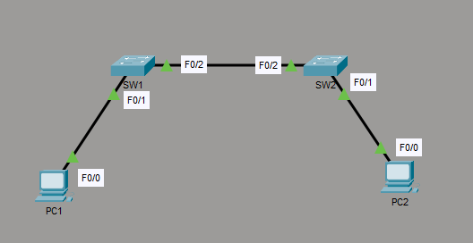

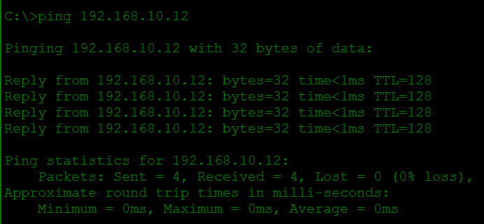

## Part 2: Manual on one side only

```
SW1# configure terminal
SW1(config)# interface gigabitEthernet 0/1
SW1(config-if)# speed 100
SW1(config-if)# duplex full
SW1(config-if)# end
```

Result:

```
SW1 Gi0/1   full    100      <- typed by hand. No "a-".
SW2 Gi0/1   a-full  a-100    <- SW2 is on auto. "a-" = value came from auto.
```

On `Gi0/1`, Packet Tracer gave SW2 `a-full`. On a real switch it would usually fall back to `a-half`. I do not know why Packet Tracer gave full on that Gigabit port. Ping still worked. (Later, on `Fa0/2`, Packet Tracer did fall back to half, as the theory says. See Part 4.)

## Part 3: Force a real duplex mismatch

Goal: SW1 `full 100` and SW2 `half 100`, both typed by hand.

- On `Gi0/1`, SW2 accepted `duplex half` but did **not store it**. The running config showed only `speed 100`, and the status stayed `a-full`. I do not know why. A Cisco Community thread says half-duplex gigabit hardly exists and copper gigabit ports often support only full at gigabit speed. That is about real hardware, and I could not confirm it for Packet Tracer.
- I moved the switch link to the FastEthernet ports `Fa0/2` on both switches. SW2 `Fa0/2` then accepted half:

```
SW2  Fa0/2  notconnect 1  half  100
SW1  Fa0/2  notconnect 1  full  100
```

**Pictures: both sides typed by hand, no `a-`**

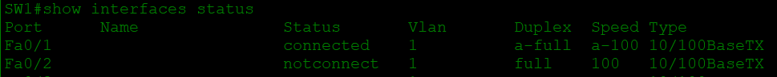


- Result: in Packet Tracer the forced mismatch brought the link **down**. Lights red, status `notconnect`, ping: 4 sent, 0 received, 100% loss. On a real switch the link would stay **up/up** with collisions on SW2 and runts and CRC on SW1.

**Pictures: the link goes down in Packet Tracer**

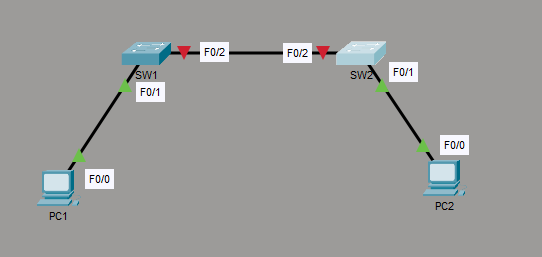

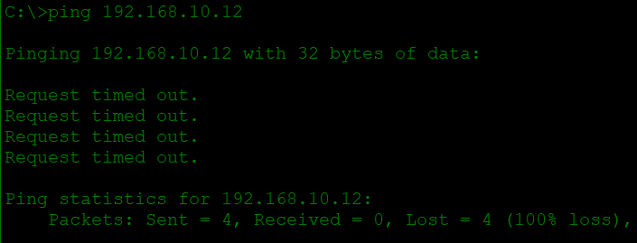

## Part 4: Fix (best way)

`speed auto` and `duplex auto` on `Fa0/2` of both switches. Result:

```
SW1  Fa0/2  connected  1  a-full  a-100
SW2  Fa0/2  connected  1  a-full  a-100
```

Links green, ping works.

**Picture: both sides on auto (`a-full a-100`, one switch shown)**

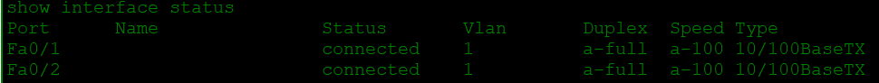

An in-between step I also saw: when I put only SW1 on auto and left SW2 on `half 100` (typed by hand), the link came back, but SW1 showed `a-half a-100`. So the auto side fell back to half duplex, as the theory says. Both sides were half, so it works but it is slow. The best fix is both sides on auto.

**Picture: SW1 on auto, SW2 typed half. SW1 fell back to `a-half`**

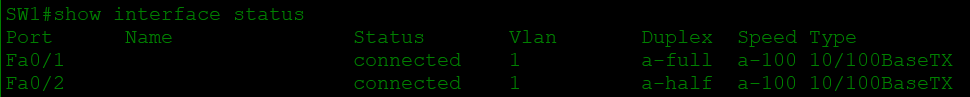

## Part 5: Shut a port

```
SW1(config)# interface fastEthernet 0/1
SW1(config-if)# shutdown
```

(My screenshot shows `Fa0/1` shut on SW1, the port of PC1. Shutting either PC port makes the ping fail.)

Result:

```
Fa0/1   disabled   1   auto   auto   10/100BaseTX
```

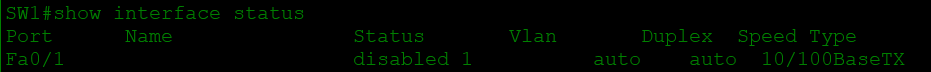

PC1 to PC2 ping: request timed out. That link went red. `disabled` = typed `shutdown`. Then:

```
SW1(config-if)# no shutdown
```

Link green, ping works.

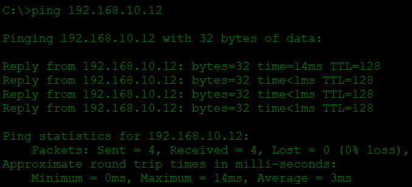

**What I got wrong:** when I wrote the sequence from memory I forgot the line that enters the port before `no shutdown`. It worked the first time only because I was already inside the interface mode.

## What I learned about Packet Tracer (differences from a real switch)

- Its error counters are fixed sample numbers. Both switches showed the same 956 packets in and 2357 packets out. I cannot see real CRC, runts, or collisions there. These same numbers appear in other people's Packet Tracer outputs.
- `duplex half` was accepted on `Gi0/1` but not stored. On `Fa0/2` it worked.
- A forced duplex mismatch brought the link **down**. On a real switch it stays up/up.
- `Gi0/1` linked at 100 Mb/s. I do not know why.
- Trust Packet Tracer for commands, status words, and ping. Do not trust it for error counters.

## Screenshots

The pictures are placed inside the lab parts above, next to the text they belong to. All of them are in the `images` folder.

---

# 11. Self-test (own words)

Practice questions written by my study coach. **Not from the real exam.** Cover the answers and answer in your own words first.

**Q1.** SW1 `speed 100` + `duplex full`, SW2 on auto, both copper 10/100/1000 ports. (1) What does SW2 show in `show interfaces status`? (2) What do users feel and which counters appear on each switch? (3) Two ways to fix.
- (1) Usually `a-half` and `a-100`. SW1 shows `full` and `100` without `a-`. (2) Up/up but slow. SW2 (half): collisions and late collisions. SW1 (full): runts and CRC, 0 collisions. (3) Best: `speed auto` and `duplex auto` on SW1. Or `speed 100` and `duplex full` on SW2, so both are manual and equal. Making SW1 half works but throws away full duplex.

**Q2.** Status table with Gi0/2 notconnect, Gi0/3 disabled, Gi0/4 err-disabled, Gi0/5 connected `half 100`. First action for each? What looks wrong on Gi0/5?
- Gi0/2: check the cable at both ends and that the other device is on. Gi0/3: `no shutdown`. Gi0/4: find the reason in the log first, fix it, then `shutdown` and `no shutdown`. Gi0/5: half duplex with no `a-`, so it was typed by hand. Suspicious, but one side only. Read the other side first.

**Q3.** Older devices without auto-MDIX: cable for PC to switch, router to PC, switch to switch? Why for router to PC in pins? Could `speed 100` and `duplex full` on an auto-MDIX switch port cause trouble with a straight cable between two switches?
- Straight, crossover, crossover. Both router and PC are MDI and send on pins 1,2, so a straight cable would put send against send. Yes: Cisco says auto-MDIX needs speed and duplex on auto, so it may stop working.

**Q4.** SW1 SX (850 nm), SW2 LX/LH (1310 nm), single-mode cable, 3 km, link down. Two reasons? Smallest fix? Separately: LX/LH Rx -2.0 dBm, OK?
- Different SFP types; SX is multimode only; 3 km is beyond SX (about 550 m). Fix: LX/LH at SW1 (so both match), then check Tx/Rx and connectors. Rx -2.0 is above the top of the range (-3): **too strong**, not OK.

**Q5.** After clearing counters 10 minutes ago: full duplex 100 Mb/s, 4000 CRC, 900 runts, 0 collisions. Main suspect? What to check on the other switch? What result would make you suspect the cable?
- Duplex mismatch with this port as the full side (live fault, runts, CRC, 0 collisions). Check duplex, speed, collisions, late collisions on the other switch. If the other side is full, matching, with no collisions, suspect the cable path.

**Q6.** Pins for MDI and MDIX? Wire pairs for 100BASE-TX and 1000BASE-T? Maximum copper length? What does `a-` tell you and not prove? Which is stronger, -8 or -15 dBm? CRC vs FCS?
- MDI sends 1,2 receives 3,6. MDIX sends 3,6 receives 1,2. 2 pairs and 4 pairs. 100 m. `a-` = the value came from auto; it does not prove the other side agrees. -8 dBm. CRC = the method, FCS = the field holding the result.

**Q7.** Commands: set 100 full by hand; back to auto; speed and duplex table; counters and light levels; reset counters of one port; port off and on. (Write the modes too.)
- See "7. Commands" above.

**Q8.** Two outputs (Section 3.5). Problem, 3 clues, which switch is manual, and the fix.
- Duplex mismatch. SW1 `full 100` without `a-` is manual. SW2 `a-half a-100` is auto. Fix: SW1 `speed auto` and `duplex auto`.

**Q9.** In simple words: why does a mismatch stay up/up and is still a problem? Why must both SFPs match? Why is "no errors" not enough for fiber?
- The link signal does not track duplex, but the two sides disagree on who may talk, so frames crash or get cut short, resends make it slow. Same wavelength and fiber type, otherwise they cannot read each other's light. Light can be too weak or too strong before errors start.

**Q10.** Ticket: floor 3 slow since this morning, port Gi0/12, you only reach SW1. Plan.
- See Section 6.6.

---

# 12. My mistake log

| What I got wrong | The correct idea |
|---|---|
| One side manual, one auto: I did not know the result | The auto side learns the speed but not the duplex. It usually ends half. Mismatch. |
| Said "duplex mismatch" from a status line alone | Up/up and slow is a clue, not proof. Read both sides and the counters. |
| Said "the half side can send and listen at the same time" | Half duplex cannot send and receive data at the same time. It listens while sending only to catch a crash. |
| Gave the name of FCS but not the meaning | FCS is the field at the end of a frame that holds the CRC check number. |
| err-disabled: said "replace the port" | Find the reason first. |
| Switch pins: said 1,2,7,8 send and 3,4,5,6 receive | Switch (MDIX) sends on 3,6 and receives on 1,2. |
| Said 1000BASE-T uses 1 pair | It uses 4 pairs. |
| Said `a-` means full duplex | It means the value came from auto. |
| Said Rx -2.0 dBm is "too low" | It is too strong. Closer to zero is stronger. |
| Said the mismatch problem is speed | The problem is collisions and damaged frames. Speed is the same on both sides. |
| Used fiber words (cladding) for a copper link | Cladding is a fiber word. |
| Named the wrong switch as manual (read the `a-` prefix wrongly) | No `a-` means typed by hand. |
| Forgot the interface line before `no shutdown` | Enter the port, then flip the switch. |
| Answered a prediction with "auto" for a connected port | A connected port shows what it uses now, with `a-` if it came from auto. |
| Did not name counters on each side of a mismatch | Half side: collisions and late collisions. Full side: runts and CRC. |

---

# 13. Word list

| Word | Simple meaning |
|---|---|
| Bit / Byte | Smallest piece of data (0 or 1) / 8 bits |
| Mbps | Megabits per second (speed unit) |
| Frame | One "parcel" of data on an Ethernet cable |
| Port | The socket on a switch where a cable plugs in |
| Hub | Old device that copies data to all ports on one shared wire (half duplex) |
| Duplex | Can the link send and receive at the same time (full) or one at a time (half) |
| CSMA/CD | The listen-first rule of half duplex: listen, send, and if two send together, wait a random time and resend |
| Auto-negotiation | Two ports agree on the best speed and duplex |
| Parallel detection | A port measures the speed from the signal when the other side does not negotiate. It cannot learn the duplex |
| a- prefix | In `show interfaces status`: the value came from auto. It does not prove the other side agrees |
| Collision | Two devices on half duplex send at the same time |
| Late collision | A collision that happens late in a frame (after the first 64 bytes). Points to a duplex mismatch (half side) or a cable that is too long |
| CRC (Cyclic Redundancy Check) | A math check on a frame. A different result on arrival means the frame is damaged |
| FCS (Frame Check Sequence) | The field at the end of a frame that holds the CRC result |
| CRC error | The check failed, so the frame was damaged. It is dropped |
| Runt | Frame smaller than 64 bytes with a bad check number |
| Giant | Frame bigger than 1518 bytes (non-jumbo) with a bad check number |
| Alignment error | Frame that does not end on a whole byte, with a bad check number |
| Input errors | Total count of bad frames received |
| Cumulative | Counters keep adding up until cleared |
| Live fault | The problem is happening now, not in the past |
| NIC (Network Interface Card) | The part in a PC or server that connects it to the cable |
| UTP (Unshielded Twisted Pair) | Normal copper network cable: 4 pairs of twisted wires, no metal shield |
| RJ-45 | The plastic plug at the end of an Ethernet copper cable |
| Re-seat | Remove the plug and push it back in firmly |
| Attenuation | The signal gets weaker over distance |
| Interference / Noise | Electrical noise from motors and power cables that damages the signal |
| Flapping | A port keeps going up and down |
| Pin | One small metal contact in the plug (numbered 1 to 8) |
| MDI / MDIX | MDI sends on 1,2 and receives on 3,6 (PC, router). MDIX is the opposite (switch, hub) |
| Straight-through / Crossover | Pin 1 to pin 1 / pins 1,2 swapped with 3,6 |
| Auto-MDIX | Port detects the cable type and fixes the pins. Needs speed and duplex on auto |
| Fiber | A thin glass strand that carries data as light |
| Core / Cladding | The thin glass center where light travels / the glass wall that keeps the light inside |
| Single-mode / Multimode | Two fiber types. Single-mode goes much farther |
| Laser / LED | Strong narrow light (single-mode) / simple cheaper light (multimode) |
| Wavelength (nm) | The "color" of the light, in nanometers (850 nm and 1310 nm are invisible infrared) |
| SFP (Small Form-factor Pluggable) | Small plug-in module in a switch slot for fiber or copper |
| Mode conditioning patch cable | Special cable that adjusts the light from an LX/LH SFP going onto older multimode fiber |
| Tx / Rx | Transmit (send) power / receive power |
| dBm | Unit of light power. 0 dBm = 1 milliwatt. Closer to zero is stronger |
| DOM | Digital Optical Monitoring. An SFP feature that reports its own light levels |
| Threshold | The limit value. Crossing it triggers a warning or alarm |
| Layer 1 / Layer 2 | Cable, plugs, and signal / frames moving between two devices on the same link |
| Line protocol | The switch's own check that the link is usable at Layer 2 |
| up/up | First up = signal on the cable. Second up (line protocol) = link is usable |
| administratively down / disabled | Someone typed `shutdown` |
| notconnect | The switch sees no signal on the port |
| err-disabled | The switch shut the port by itself because of a problem |
| Topology / Baseline | The picture of how devices connect / the normal working state before changes |
| Hostname | The name of a device (for example SW1) |

---

# 14. Sources checked

- Cisco tech note: "Configure and Verify Ethernet 10/100/1000Mb Half/Full Duplex Auto-Negotiation" (document ID 10561): https://www.cisco.com/c/en/us/support/docs/lan-switching/ethernet/10561-3.html
- Cisco Gigabit Ethernet SFP data sheet (1000BASE-SX, LX/LH, EX, ZX distances and power ranges).
- Cisco Catalyst switch configuration documentation on auto-MDIX (command `mdix auto`, needs speed and duplex on auto).
- Checked on 4 Oct 2026. Packet Tracer observations are from my own lab.

---

*Checked for technical mistakes before publishing: yes, by my study coach, 4 Oct 2026. The coach can be wrong too, so verify important commands in a lab or Cisco documents.*
