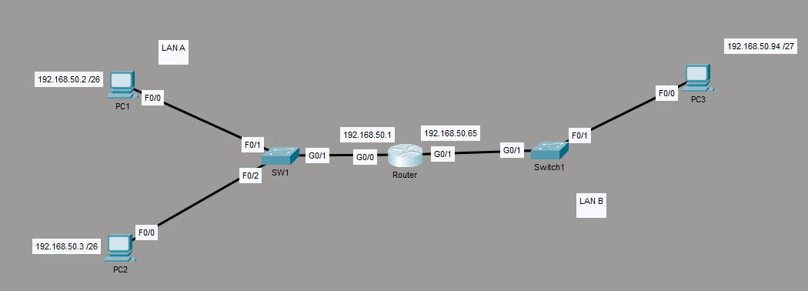
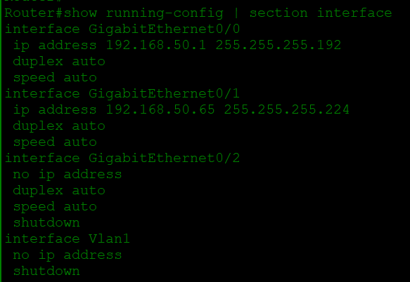
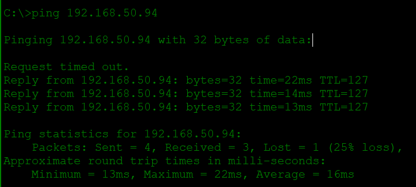

# 1.3 Troubleshoot IPv4 address configuration, assignment, and subnetting (public and private)

**Exam:** CCNA 200-301 v2.0 (live from 3 Feb 2027)
**Status:** Studied, lab done, Mistake Log written. Notes checked on 2026-10-14.
**Honest note:** Commands and facts here are from my study and my lab. Verify important ones in Jeremy's IT Lab videos or Cisco docs. Anything marked *(check Cisco docs)* I am not fully sure about.

---

## Contents

1. Public, private, and special addresses
2. Subnet math: the block trick
3. Same subnet, different subnet, and the gateway
4. How a device gets its address (static, DHCP, APIPA)
5. Choosing the right mask for the number of hosts
6. Troubleshooting checklist and reading show output
7. Lab: two LANs from 192.168.50.0/24
8. Common mistakes
9. Must memorize
10. Word list
11. Mistake Log
12. My level
13. What is not in this topic

---

## 1. Public, private, and special addresses

**Why:** There are only about 4.3 billion IPv4 addresses. There are far more devices. So private addresses are reused inside homes and offices, and one public address is shared.

- **Private** = free to reuse inside a home or office. Like "House 12": every street has one.
- **Public** = unique on the internet. Like a CNIC number.
- The router at the edge changes private addresses to a public one. This is called **NAT** (learn it fully in topic 4.3).

### The three private ranges (RFC 1918)

| Range | Easy way to remember |
|---|---|
| 10.0.0.0 to 10.255.255.255 | Anything starting with 10 |
| 172.16.0.0 to 172.31.255.255 | 172, and the **second** number is 16 to 31 |
| 192.168.0.0 to 192.168.255.255 | 192.168, then anything |

### Special addresses

| Address | What it is |
|---|---|
| 127.0.0.0 to 127.255.255.255 | **Loopback.** The device talks to itself. 127.0.0.1 is the usual one. |
| 169.254.x.x | **APIPA.** A Windows PC gave itself this because no DHCP server answered. |
| 224.0.0.0 to 239.255.255.255 | **Multicast.** One sender, a group of receivers. |

Anything else that is a valid address is public.

**Always check first:** every part of an IPv4 address must be **0 to 255**. `192.168.300.1` is **invalid**, not private.

```
Which is private?
172.15.1.1   -> public   (second number must be 16 to 31)
172.20.8.1   -> private  (20 is between 16 and 31)
172.32.4.9   -> public
192.169.1.5  -> public   (only 192.168 is private)
11.0.0.9     -> public
```

`ping 127.0.0.1` tests the PC's own network software. It does not leave the PC.

---

## 2. Subnet math: the block trick

**Why:** With /26, /27 and so on, you cannot see the subnet by looking. Without a method you guess.

**Idea:** The mask cuts the numbers 0 to 255 into equal blocks. Two addresses are in the same subnet only if they are in the same block.

Real-life comparison: a housing society with Block A, Block B. Plot 100 lives in the block that contains it. *Where it breaks:* subnet blocks are always a power of 2, and they start at a multiple of their own size.

### Step 1: block size (two ways, same answer)

```
Way 1: 256 minus the last mask number that is not 255
       /26 = 255.255.255.192  ->  256 - 192 = 64

Way 2: host bits = 32 minus the slash number
       /26 -> 32 - 26 = 6 host bits -> 2^6 = 64
```

### Step 2: list the blocks (count by the block size from 0)

```
/26, block size 64:
 0 ..... 63 | 64 ..... 127 | 128 ..... 191 | 192 ..... 255
```

Blocks **start at a multiple of the block size**. They never start at a random number.

### Step 3: find the block that holds the host

```
Network address   = first number in the block
Broadcast address = last number in the block
Usable range      = network + 1  to  broadcast - 1
```

The network address (the name of the subnet) and the broadcast address (talks to everyone in the subnet) are **never given to a PC**.

### Table to learn

| Mask | Last mask number | Block size | Usable hosts |
|---|---|---|---|
| /24 | 0 | 256 | 254 |
| /25 | 128 | 128 | 126 |
| /26 | 192 | 64 | 62 |
| /27 | 224 | 32 | 30 |
| /28 | 240 | 16 | 14 |
| /29 | 248 | 8 | 6 |
| /30 | 252 | 4 | 2 |

Usable hosts = 2^(host bits) - 2. Each longer mask halves the block.

(/31 and /32 have special uses. *Check Cisco docs.*)

### Worked example A: /26, host 192.168.1.100 (block in the 4th number)

```
Block size 64.  Count: 0, 64, 128 ...  64 <= 100 < 128
Network:   192.168.1.64
Broadcast: 192.168.1.127
Usable:    192.168.1.65 to 192.168.1.126
```

### Worked example B: /27, host 192.168.100.77

```
Block size 32.  Count: 0, 32, 64, 96   64 <= 77 < 96
Network:   192.168.100.64
Broadcast: 192.168.100.95
Usable:    192.168.100.65 to 192.168.100.94
```

### Masks bigger than /24: the block moves to the THIRD number

Find the mask number that is not 255 and not 0. That number is the "interesting" one. The block is in that position, and the numbers after it go from 0 up to 255.

**Example C: /22 (255.255.252.0), host 172.16.37.10**

```
Interesting number: 252, in the 3rd position. Block size = 256 - 252 = 4
Count by 4: 0, 4, 8 ... 32, 36, 40     36 <= 37 < 40
Network:   172.16.36.0
Broadcast: 172.16.39.255      <- 4th number runs to 255
Usable:    172.16.36.1 to 172.16.39.254
Hosts:     32 - 22 = 10 host bits -> 2^10 - 2 = 1022
```

**Example D: /21 (255.255.248.0), host 10.20.70.5**

```
Block size = 256 - 248 = 8.   Count by 8: 0, 8 ... 56, 64, 72    64 <= 70 < 72
Network:   10.20.64.0
Broadcast: 10.20.71.255
```

**Example E: /20 (255.255.240.0), host 172.20.150.9**

```
Block size = 256 - 240 = 16.  Count by 16: ... 128, 144, 160    144 <= 150 < 160
Network:   172.20.144.0
Broadcast: 172.20.159.255
Usable:    172.20.144.1 to 172.20.159.254
```

**Check every answer:** is the host inside my block? Does the block start at a multiple of the block size?

---

## 3. Same subnet, different subnet, and the gateway

**Rule:** Before sending, a PC uses only its own IP and mask to decide:

```
Is the destination in MY block?
     YES -> send directly (uses ARP to find the other device's MAC address)
     NO  -> send to the default gateway (the router)
```

Real-life comparison: students in the same classroom talk directly. For another school, the message goes to the principal's office first. *Where it breaks:* the PC never asks the gateway whether a device is in its subnet. It decides alone.

### The gateway must be

1. In the **same subnet** as the PC (the PC has to reach it directly)
2. A **usable** address (not the network or broadcast address)
3. The **real** address of a router interface (an address no router uses is a shop sign with no shop)

### Different subnets

- Two hosts in different subnets cannot talk without a router. Changing the mask on only one of them does not fix it. **Both sides must agree.**
- A normal switch does not connect different subnets.

### Example: gateway hidden in a different block

```
Server  192.168.1.130  mask /25  gateway 192.168.1.1

/25 blocks:  0 ........ 127  |  128 ........ 255
Server .130 -> block 128-255
Gateway .1  -> block 0-127      DIFFERENT subnet -> server cannot reach gateway
```

Fix: change the server to an address in .2 to .126, or move the gateway into the 128-255 block. Check the real router first.

### Gateway fault checklist (in order)

1. Is the gateway in the PC's block?
2. Is the gateway a usable address?
3. Do both devices have matching masks?
4. Is there a duplicate IP address?

---

## 4. How a device gets its address

| Way | What | Used for |
|---|---|---|
| Static | Typed by hand | Routers, servers, printers (others must find them) |
| DHCP | A server hands out settings | User PCs, phones, laptops |

### DHCP: DORA

```
 PC (no address)                          DHCP server
   -- 1. DISCOVER "Any DHCP server?" --->  (broadcast)
   <- 2. OFFER    "Take 192.168.1.50"   --
   -- 3. REQUEST  "Yes, I want .50"     --->
   <- 4. ACK      "Yours for X hours"   --
```

- The address is a **lease** (it runs out and must be renewed).
- DHCP gives **IP, mask, default gateway, and DNS server**. A wrong gateway from DHCP breaks the internet even when the IP looks fine.
- Windows: `ipconfig /all` (shows `DHCP Enabled`, `DHCP Server`, lease times), `ipconfig /release`, `ipconfig /renew`.
- If the DHCP server is on a different subnet, the router needs a **relay** (`ip helper-address`). I only know the name for now. Topic 1.7 covers it.

### 169.254.x.x (APIPA)

Means the PC asked for an address and got no answer.

```
One PC has 169.254, others are fine  -> the problem is on THAT PC's side:
   bad cable or port, wrong VLAN, wrong Wi-Fi network, bad network card

ALL NEW PCs have 169.254, old PCs fine -> think about the server side:
   the pool is full, the DHCP server stopped (old PCs keep their lease
   until it runs out), or the relay is missing
```

---

## 5. Choosing the right mask for the number of hosts

**Idea:** Count the hosts you need, add 2 (network and broadcast), and pick the **smallest** block that fits.

```
Need 100 hosts?
/26 -> 62 usable   (too small)
/25 -> 126 usable  (fits)  <- smallest that fits
```

- Always check the next smaller size, to prove yours is the smallest.
- "At least 50 hosts" or "smallest subnet" -> find the smallest block that fits.
- If the router interface is counted as a host, add it to the host count.
- 30 hosts fit in a /27 (exactly 30 usable). 31 hosts do not.

---

## 6. Troubleshooting checklist and reading show output

### Check from the bottom up

```
1. Is the interface up/up?            (cable, port, shutdown)
2. Is the IP and mask correct?        (typo, wrong mask, not a usable address)
3. Is the gateway correct?            (same subnet, usable, real router address)
4. Is there a duplicate IP?
5. If DHCP: did it work?              (169.254, empty pool, wrong VLAN, relay)
6. Ping from near to far:
   127.0.0.1 -> own IP -> gateway -> a device beyond the gateway
```

### Reading `show ip interface brief`

```
R1# show ip interface brief
Interface            IP-Address     OK? Method Status                Protocol
GigabitEthernet0/0   192.168.1.1    YES manual up                    up
GigabitEthernet0/1   unassigned     YES unset  administratively down down
```

| Part | Meaning |
|---|---|
| IP-Address | The IP on this interface. `unassigned` = none yet |
| Method `manual` | Typed by hand. `DHCP` = got it from a DHCP server |
| `administratively down` | Someone typed `shutdown`. Fix: `no shutdown` on that interface |
| `up / up` | The interface works |

**`up/up` does not show the mask or prove the IP settings are right.** To see the mask, look at `show running-config` for that interface.

### The ping ladder

```
Ping 127.0.0.1 works       -> PC network software OK
Ping own IP works          -> PC settings OK
Ping gateway fails         -> look at gateway, mask, cable, VLAN
Ping gateway works, ping beyond fails -> the fault is past the PC (router, ISP, routing)
```

If a ping by **name** fails but a ping to a public IP like 8.8.8.8 works, think **DNS**.

The first ping in Packet Tracer can time out while devices learn each other's addresses. Look at pings 2 to 4. A ping that keeps failing is a real fault.

### TTL (what I saw in my lab)

```
PC2 (same LAN)       TTL=128   (Windows start value, no router in between)
Router               TTL=255   (Cisco router start value)
PC3 (other LAN)      TTL=127   (128 minus 1 router)
```

So TTL can show how many routers a packet passed. *(Check start values in Cisco docs.)*

---

## 7. Lab: two LANs from 192.168.50.0/24

**Task:** LAN A needs 50 hosts, LAN B needs 25 hosts. Use the smallest mask for each. LAN B goes in the next free block after LAN A. The router uses the first usable address of each subnet as the gateway. PC3 uses the last usable address of LAN B. PC1 must ping PC3.

### Topology

```
 PC1 --\                                  /-- PC3
        [SW1] ---- [R1] ---- [SW2] -------
 PC2 --/    G0/0       G0/1
          LAN A              LAN B
```



### Subnet table

| | LAN A | LAN B |
|---|---|---|
| Hosts needed | 50 | 25 |
| Mask | /26 (255.255.255.192) | /27 (255.255.255.224) |
| Why | /26 = 62 usable (fits 50) | /28 = 14 (too small), /27 = 30 (fits 25) |
| Block size | 64 | 32 |
| Network | 192.168.50.0 | 192.168.50.64 |
| Broadcast | 192.168.50.63 | 192.168.50.95 |
| Usable | 192.168.50.1 to 192.168.50.62 | 192.168.50.65 to 192.168.50.94 |
| Router gateway | 192.168.50.1 (G0/0) | 192.168.50.65 (G0/1) |

The next free block after LAN B starts at 192.168.50.96.

### Devices

| Device | IP | Mask | Gateway |
|---|---|---|---|
| PC1 | 192.168.50.2 | 255.255.255.192 | 192.168.50.1 |
| PC2 | 192.168.50.3 | 255.255.255.192 | 192.168.50.1 |
| PC3 | 192.168.50.94 | 255.255.255.224 | 192.168.50.65 |

### Router config (from my router)

```
interface GigabitEthernet0/0
 ip address 192.168.50.1 255.255.255.192
!
interface GigabitEthernet0/1
 ip address 192.168.50.65 255.255.255.224
```

Command pattern: `interface <name>`, then `ip address <ip> <mask>`, then `no shutdown` to turn the port on. A router port starts shut. *(Verify in Jeremy's videos or Cisco docs.)*



### Result

PC1 pings PC3. The first ping timed out (normal, devices were learning), then 3 of 3 replies with TTL=127.



### The fault I found: a VLAN I created by mistake

```
PC1 <-> PC2     worked      (both ports in the same VLAN)
PC1 -> gateway  FAILED      (the router port was in a different VLAN)
Link lights     all green   (green = the cable works, not that the VLAN is right)
```

- Clue: PC-to-PC worked, but PC-to-gateway failed. The fault was between the PCs' group and the router port.
- Cause: I had created VLANs on both switches, and the router-facing port was not in the same VLAN as the PCs.
- Fix: put the PC ports and the router-facing port back in VLAN 1 on both switches (pattern: `switchport access vlan 1`; check with `show vlan brief`). *(Verify in Cisco docs. VLANs are topic 2.2.)*
- Trap: deleting a VLAN with `no vlan <number>` does **not** move its ports. They stay assigned to the deleted VLAN and go inactive. Move the ports first.

---

## 8. Common mistakes

| People think | The truth |
|---|---|
| Any address starting with 172 is private | Only 172.16 to 172.31 is private |
| 192.168.300.1 is private | It is invalid. Parts must be 0 to 255 |
| The usable range is the whole block | The first (network) and last (broadcast) addresses are not for PCs |
| A switch connects different subnets | A normal switch does not. A router does |
| Changing one mask fixes a subnet problem | Both sides must agree |
| DHCP gives only the IP | It also gives mask, gateway, and DNS |
| 169.254 means the DHCP server is broken | If only one PC has it, check that PC's cable, port, and VLAN first |
| up/up means the IP settings are right | It only means the interface works |
| Green link lights mean everything is fine | They do not show a wrong VLAN, mask, or gateway |
| A /22 has a block size of 64 | Block size = 256 - 252 = 4, and it is in the third number |

---

## 9. Must memorize

**Addresses**
- Private: `10/8`, `172.16 to 172.31`, `192.168/16`
- Loopback `127.x.x.x`. APIPA `169.254.x.x`. Multicast `224 to 239`
- Every part of an IPv4 address is 0 to 255

**Subnet math**
- Block size = 256 minus the interesting mask number. Host bits = 32 minus the slash number
- Mask numbers: 128, 192, 224, 240, 248, 252
- Usable: /25 = 126, /26 = 62, /27 = 30, /28 = 14, /29 = 6, /30 = 2. Usable = 2^(host bits) - 2
- Blocks start at a multiple of the block size. Count from 0
- First address = network, last = broadcast. Neither is for a PC
- Mask bigger than /24: the block is in the third number, and the 4th number runs 0 to 255

**Gateway and DHCP**
- Same subnet = direct. Different subnet = gateway
- Gateway: same subnet, usable, a real router address
- DORA: Discover, Offer, Request, Acknowledge
- DHCP gives IP, mask, gateway, DNS. 169.254 = DHCP failed

**Commands and tests**
- `ipconfig /all`, `/release`, `/renew`
- `show ip interface brief`. `administratively down` = shut. `no shutdown` turns it on
- Ping order: 127.0.0.1, own IP, gateway, then beyond
- TTL: Windows 128, Cisco router 255, minus 1 per router *(check Cisco docs)*

---

## 10. Word list

| Word | Simple meaning |
|---|---|
| Subnet | A smaller network. Devices in it can talk without a router |
| Subnet mask | Numbers that show which part of the address is the network |
| Network address | First address of a subnet. The subnet's name |
| Broadcast address | Last address of a subnet. Talks to everyone in it |
| Usable address | An address you can give to a device |
| Host | Any device with an address |
| Default gateway | The router address a device uses to leave its own network |
| Private address | Address reused inside homes and offices |
| Public address | Address that is unique on the internet |
| NAT | Router changes private addresses to a public one |
| DHCP | A server that gives out addresses automatically |
| Lease | The time a DHCP address is yours before it must be renewed |
| APIPA | The 169.254.x.x address a PC gives itself when DHCP fails |
| Loopback | 127.x.x.x. A device talking to itself |
| ARP | A "who has this IP?" question on the local network to find a MAC address |
| VLAN | A group of switch ports acting as one separate network |
| TTL | A number in a packet that goes down by 1 at every router |
| Pool | The range of addresses a DHCP server can hand out |

---

## 11. Mistake Log

1. Private ranges: mixed 172.16 to 172.31 with other numbers.
2. Two hosts in different subnets cannot talk without a router. Changing one mask does not fix it.
3. First address of a subnet is the network address, last is the broadcast. Neither is for a PC.
4. The gateway can hide in a different block when the mask is not /24. Check the block, not just the third number.
5. Check every number is 0 to 255 before calling an address private or public (192.168.300.1).
6. One PC has 169.254 while others are fine: check that PC's cable, port, and VLAN first.
7. For masks bigger than /24, the block is in the third number. /22 block size is 4, not 64.
8. Blocks start at a multiple of the block size. Count by it from 0 until I pass the host. Broadcast = next block start minus 1, then .255.
9. Ping works to the gateway but not beyond: the fault is past the PC. If it fails only by name, check DNS.
10. Green link lights do not prove the VLAN is right.
11. Habits to fix: write the reason with every answer, check the first line of a table, do not add a slash to broadcast or usable addresses, write a block as 144-159 (not 144-160).

---

## 12. My level

| Skill | Level |
|---|---|
| Can explain | Mostly |
| Can configure | Yes, basic (redo from memory later) |
| Can troubleshoot | Partly (needs more fast fault-finding practice) |

---

## 13. What is not in this topic

- DHCP server, client, and relay on IOS devices is **topic 1.7**.
- VLAN configuration is **topic 2.2**.
- NAT is **topic 4.3**.
- IPv6 addressing is **topic 1.4**.
