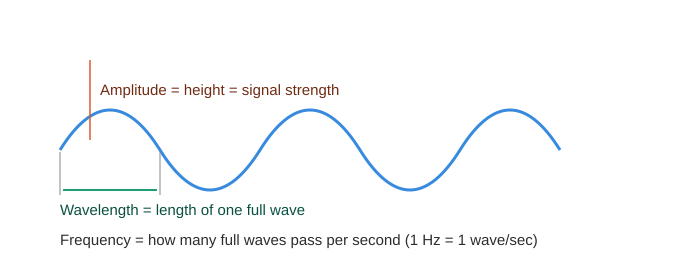
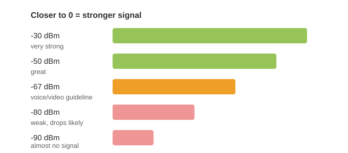
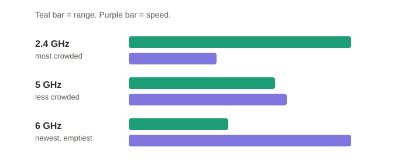
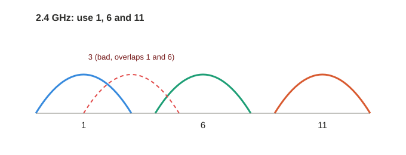
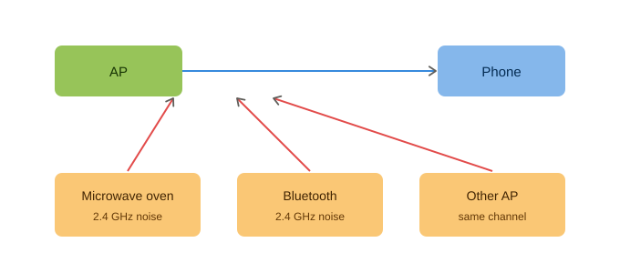
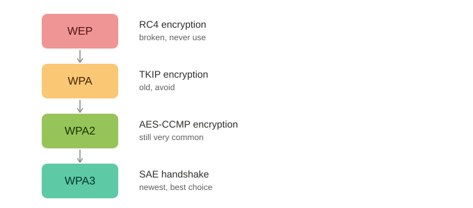
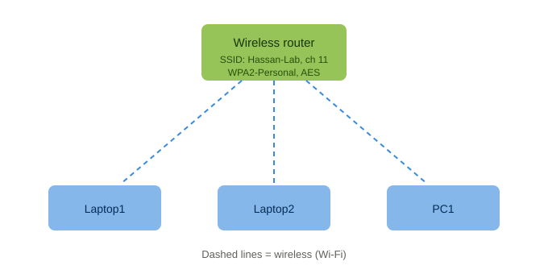

# 1.5 Wireless Principles (CCNA 200-301 v2.0)

## 1. Why Wi-Fi is different from a cable

A cable gives each device its own private path. Wi-Fi has no path — all devices share the same air.

- Wi-Fi is **half duplex**: only one device can send at a time on one channel (like a walkie-talkie).
- More devices on one channel means more waiting, so the network gets slower.
- Anyone nearby can receive your signal — this is why Wi-Fi needs strong security.

**Common mistake:** people think Wi-Fi is just a cable without the wire. Really, Wi-Fi is a shared, half-duplex medium, which makes it slower and less predictable than a cable.

## 2. RF characteristics (radio waves)

A radio wave is described by:

- **Frequency** — waves per second (Hz). Higher frequency = shorter wavelength.
- **Wavelength** — the length of one wave. Shorter wavelength = less range through walls.
- **Amplitude** — the height of the wave = signal strength.



**Higher frequency = shorter wavelength.** All radio waves travel at the same speed (speed of light), so if more waves must pass per second, each one has to be shorter — like a train at fixed speed: more coaches per minute means each coach must be shorter.

Signal strength is measured in **dBm**. Closer to 0 is stronger (values are negative).



Power math:
- +3 dB = power doubles. -3 dB = power halves.
- +10 dB = power is 10x. -10 dB = power is 1/10.

**Common mistake:** thinking -40 dBm is weaker than -70 dBm because 40 is a smaller number. The negative sign flips it — **-40 is stronger** (closer to 0).

## 3. Bands: 2.4 GHz, 5 GHz, 6 GHz



| Band | Range through walls | Crowding | Devices |
|---|---|---|---|
| 2.4 GHz | best | high (many old devices) | almost every device |
| 5 GHz | medium | medium | most modern devices |
| 6 GHz | weakest | low | only newer devices (Wi-Fi 6E / Wi-Fi 7) |

**Common mistake:** "5 GHz is always better." Really, 5 GHz is faster but loses strength faster through walls. In a far room, 2.4 GHz can be more stable.

## 4. Channels

A channel is one lane inside a band.



- **2.4 GHz:** channels overlap heavily. Only **1, 6, and 11** are non-overlapping (20 MHz width).
- **5 GHz:** many more non-overlapping channels, easier to avoid neighbors.
- Channel width (20/40/80/160 MHz): wider = faster, but fewer free channels and more interference risk.

**Common mistake:** thinking channels 1, 2, 3 are three separate lanes. They overlap heavily — only 1, 6, 11 are separate on 2.4 GHz.

**Same channel vs. overlapping channel — not the same problem:** two APs on the **same** channel can hear each other and take turns (slower, but not garbled). Two APs on **overlapping but different** channels have signals that partly mix, which is usually worse.

## 5. Interference and SNR

Interference = anything that makes the signal harder to hear clearly.



- **Wi-Fi interference:** neighbor APs on the same or overlapping channel.
- **Non-Wi-Fi interference:** microwave ovens, Bluetooth, cordless phones — mostly hit 2.4 GHz.
- Security (WPA2/WPA3) does **not** fix interference. It only controls who can join and scrambles data.

**SNR (signal-to-noise ratio):**

```
SNR (dB) = signal (dBm) - noise (dBm)

signal -60 dBm, noise -90 dBm  ->  SNR = 30 dB  (good)
signal -60 dBm, noise -70 dBm  ->  SNR = 10 dB  (bad)
```

Higher SNR is better.

## 6. Wireless security



| Protocol | Encryption |
|---|---|
| WEP | RC4 (broken, never use) |
| WPA | TKIP (old, avoid) |
| WPA2 | AES-CCMP (still very common) |
| WPA3 | SAE handshake (newest, best choice) |

Two modes:
- **Personal:** one shared password (PSK = Pre-Shared Key). Used at home/small office.
- **Enterprise:** each person has their own login, checked by a RADIUS server using 802.1X. Used at companies — lets you remove one person's access without changing the password for everyone.

**Common mistake:** hiding the SSID or MAC filtering does not scramble any data — it is not real security. Real security is WPA2 or WPA3.

## Key terms

- **SSID** — the Wi-Fi network name. One SSID can be broadcast by several access points/radios.
- **BSSID** — the MAC address of one specific radio broadcasting that SSID. Tells two APs with the same name apart. Example from my own router: SSID "Nayatel" had one BSSID on 2.4 GHz and a separate BSSID for "Nayatel 5G".
- **AP (Access Point)** — bridges wireless clients to the wired network. A home "Wi-Fi router" is usually router + switch + AP combined in one box; in enterprise Cisco networks these are separate devices.

---

# Lab: Home Wi-Fi Network (Packet Tracer)

## Topology



## Router configuration
- SSID: `Hassan-Lab`
- Band: 2.4 GHz, Channel: 11
- Security: WPA2 Personal, Encryption: AES
- Passphrase: 10+ characters (WPA2 requires at least 8)

## Client setup (Laptop1, Laptop2, PC1)
Added a wireless NIC module (WPC300N) via Physical tab (device powered off first). In Config > Wireless0:
- SSID: `Hassan-Lab` (case sensitive, must match exactly)
- Authentication: WPA2-PSK (not WPA-PSK — different protocols, must match the router exactly)
- Encryption: AES
- PSK Pass Phrase: matches the router
- IP Configuration: DHCP

## Verification — ipconfig (Wireless0)

| Device | IPv4 Address | Subnet Mask | Default Gateway |
|---|---|---|---|
| Laptop1 | 192.168.0.100 | 255.255.255.0 | 192.168.0.1 |
| Laptop2 | 192.168.0.102 | 255.255.255.0 | 192.168.0.1 |
| PC1 | 192.168.0.103 | 255.255.255.0 | 192.168.0.1 |

All three devices received an address from the router's DHCP server — proof the Wi-Fi join succeeded (a failed join gives a self-assigned 169.254.x.x address instead).

## Connectivity test — ping (Laptop1 -> PC1)

```
C:\>ping 192.168.0.103

Reply from 192.168.0.103: bytes=32 time=98ms TTL=128
Reply from 192.168.0.103: bytes=32 time=34ms TTL=128
Reply from 192.168.0.103: bytes=32 time=53ms TTL=128
Reply from 192.168.0.103: bytes=32 time=47ms TTL=128

Packets: Sent = 4, Received = 4, Lost = 0 (0% loss)
```

TTL=128 and 0% loss confirm both devices are on the same subnet with a working link.

## Break / fix test — wrong passphrase

Changed PC1's PSK Pass Phrase to a wrong value and re-ran `ipconfig`. PC1 no longer received a real address from the router (fell back to a self-assigned 169.254.x.x address), and the ping failed.

**Why it fails:** the router and the client both use the passphrase to generate the encryption keys used to join and protect the connection. A wrong passphrase produces different keys, so the router rejects the client. With no successful join, no DHCP offer is received, and the client falls back to a self-assigned APIPA address (169.254.x.x).

Restoring the correct passphrase fixed it — PC1 got 192.168.0.103 back and the ping to Laptop1 succeeded again.

## Mistake made and fixed (earlier attempt, SSID `Ahmad-Lab`)

Accidentally set the laptops' authentication to **WPA-PSK** instead of **WPA2-PSK**, while the router was configured for WPA2 Personal. Result: both laptops got 169.254.x.x addresses and could not join. Found this by reading `ipconfig` output and comparing router vs. client settings line by line. Fixed by changing both laptops to WPA2-PSK.

**Lesson:** the security *type* must match the router exactly — WPA and WPA2 look similar in a dropdown list but are different protocols and will not interoperate.

## Real-world check (own home Wi-Fi)

Also checked a real laptop on real home Wi-Fi with `netsh wlan show interfaces` and `ipconfig /all`:

| Reading | Value | Meaning |
|---|---|---|
| Band / Channel | 2.4 GHz / 1 | Matches a non-overlapping channel |
| Authentication / Cipher | WPA2-Personal / CCMP | Same protocol pair as the lab |
| Rssi | -80 dBm | Below the -67 dBm voice/video guideline — weak |
| Ping to gateway | 0% loss, but times varied 2-77 ms | Jitter from a weak link — works, but not smooth |

This matched the theory: a weak signal doesn't always mean total failure, it can mean a working but unstable connection.

---

## Must memorize

- Wi-Fi is half duplex — one device sends at a time on one channel.
- Higher frequency = shorter wavelength = less range through walls.
- dBm: closer to 0 is stronger. +3 dB = double power, +10 dB = 10x power.
- SNR (dB) = signal (dBm) minus noise (dBm). Higher is better.
- 2.4 GHz non-overlapping channels: **1, 6, 11**.
- WEP -> RC4. WPA -> TKIP. WPA2 -> AES-CCMP. WPA3 -> SAE.
- Personal = shared password (PSK). Enterprise = 802.1X + RADIUS server.
- Wrong SSID, security type, or passphrase on the client all cause a failed join and a 169.254.x.x self-assigned address.

*Verify all commands and facts in Jeremy's IT Lab videos (Day 55, Day 57) or official Cisco documentation.*
