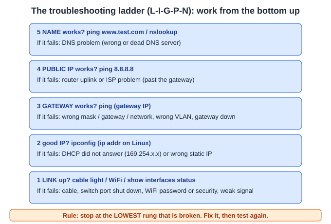
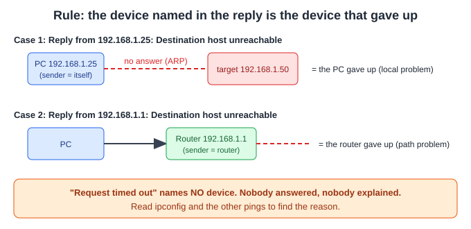
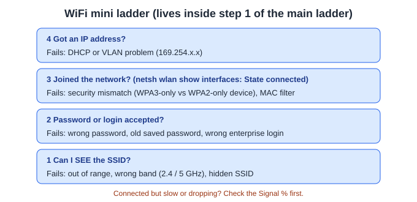
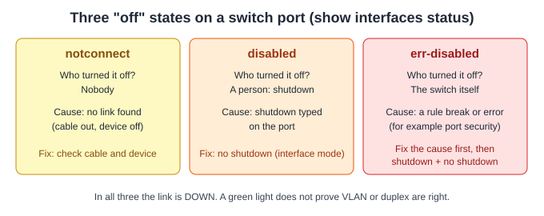
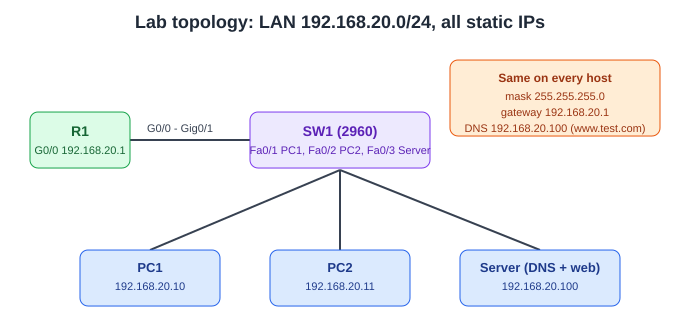
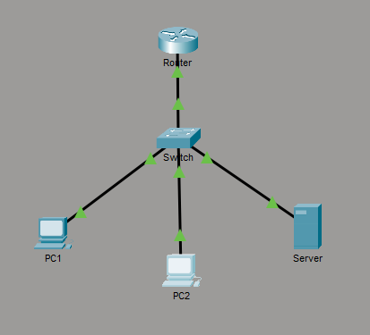
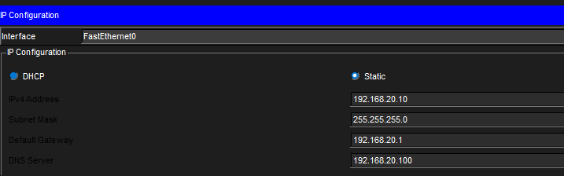
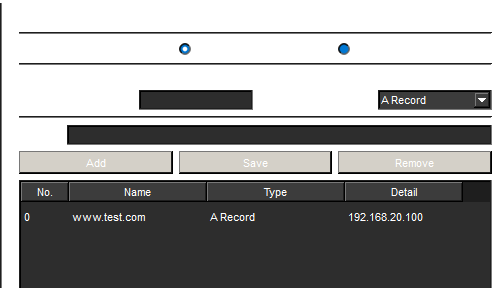
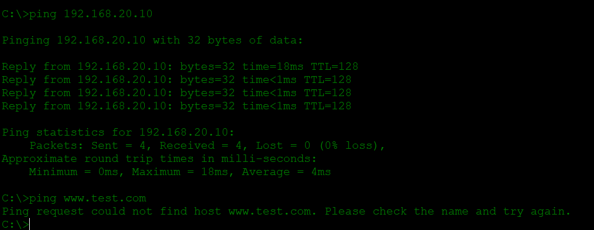
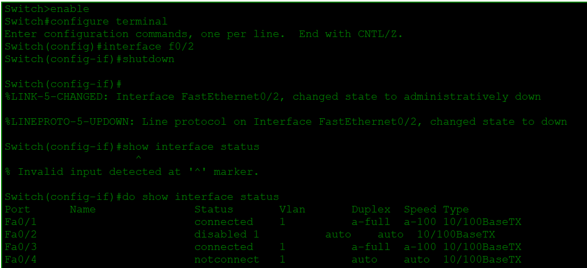

# 1.6 Troubleshoot wired and wireless client connectivity

**Exam line (CCNA 200-301 v2.0):** *Troubleshoot wired and wireless client connectivity (IP configuration, network reachability, and wireless security parameters on Windows, MacOS, and Linux).*

**Status:** learned in chat, 10-question test, Packet Tracer lab with 3 breaks. Notes written so I can revise the whole topic if I forget everything.

**Scope note:** Cisco lists the three areas above but does **not** list exact commands per operating system. The commands in this file are the common ones; the ones I checked against a source are marked **(checked)**.

**Files in this folder**

| File or folder | What it is |
|---|---|
| `notes.md` | this lesson |
| `1-6-client-connectivity.pkt` | the Packet Tracer lab (working state) |
| `lab-outputs.txt` | raw text outputs from the lab |
| `screenshots/` | 5 screenshots from my lab |
| `diagrams/` | 5 SVG diagrams used in these notes |

---

## 1. Why this topic exists

A user says "the internet is not working." That one sentence can mean 10 different faults: loose cable, wrong WiFi password, no IP address, wrong gateway, broken DNS, ISP down. If I guess, I waste time. If I check in order, I find the fault fast.

**One sentence:** check from the bottom up. Stop at the lowest step that is broken.

---

## 2. The ladder (L-I-G-P-N)



| Step | Question | Test | If it fails, think |
|---|---|---|---|
| 1 | Is the **L**ink up? | Cable light. WiFi: `netsh wlan show interfaces`. Switch: `show interfaces status` | Cable, shut port, WiFi password or security, weak signal |
| 2 | Do I have a good **I**P? | `ipconfig` (Windows), `ip addr` (Linux) | DHCP failed (169.254.x.x) or wrong static IP |
| 3 | Can I reach my **G**ateway? | `ping <gateway IP>` | Wrong mask, gateway or network; wrong VLAN; gateway down |
| 4 | Can I reach a **P**ublic IP? | `ping 8.8.8.8` | Router uplink or ISP |
| 5 | Does a **N**ame work? | `ping www.test.com`, `nslookup` | DNS server wrong or dead |

**Memory hook:** Link, IP, Gateway, Public, Name. Faults: Cable, DHCP, Mask, ISP, DNS.

**Rule:** the number is the **lowest rung that is broken**, not just the first test that fails. Example: a shut switch port makes the gateway ping fail (step 3), but the real problem is step 1 (link down). If I cannot see the link, I find out after a higher test fails, and then I look at the link.

**Real-life comparison:** going by bus to a shop. Bus works (link), I have my own address (IP), I reach the bus stand of my area (gateway), the road to the other city is open (public IP), I know the shop's address from its name (DNS). **Where it breaks:** several rungs can be broken at the same time, and the ladder only tells me where to look first.

---

## 3. The 4 client settings

A PC needs **IP + mask + gateway + DNS**. If one is wrong, I get a different failure.

| Setting | Job | Wrong value looks like |
|---|---|---|
| IP address | the PC's own address | 169.254.x.x (no DHCP answer), or on the wrong network |
| Subnet mask | tells which addresses are my own "street" | local device looks far away (or far device looks local) |
| Default gateway | router for everything outside my network | local works, outside fails |
| DNS server | turns names into IP addresses | IP pings work, name pings fail |

**How the PC decides:**

```
Target IP ──► is it in MY subnet? (my IP + my mask)
                 │
         ┌───────┴────────┐
        YES               NO
         │                 │
  send directly       send to the GATEWAY
  (ARP for its MAC)   (no gateway = fails)
```

- **The gateway must be in the PC's own subnet.** Example: PC `192.168.10.25/24` with gateway `192.168.20.1` cannot work: the gateway is on another network.
- **169.254.0.0/16** is a self-made address (called APIPA or link-local). Windows and macOS give it to themselves when DHCP gets no answer. It means "no answer from DHCP." The cause can be the cable, a wrong VLAN, blocked WiFi, or a DHCP server that is down. It does **not** always mean the DHCP server is broken. Linux behaviour depends on the network manager.
- **DNS** is only for **names**. A ping to an IP address never uses DNS.

**Comparison:** DNS is the phone contacts list: tap "Ali" and the phone finds the number. **Where it breaks:** the contacts list is on my phone, but DNS lives on another device, so the PC must be told where it is.

---

## 4. Commands on the three systems

| Job | Windows | MacOS | Linux |
|---|---|---|---|
| Show IP and mask | `ipconfig` | `ifconfig` | `ip addr` |
| Show everything incl. DNS and DHCP | `ipconfig /all` | `networksetup -getinfo "Wi-Fi"` | `ip addr` + `ip route`; DNS: `resolvectl status` (systemd systems) |
| Show gateway and routes | `route print` | `netstat -rn` | `ip route` |
| Renew DHCP | `ipconfig /release` then `ipconfig /renew` | System Settings (renew lease) | depends on the tool (NetworkManager, dhclient) |
| Clear DNS cache | `ipconfig /flushdns` | `sudo dscacheutil -flushcache; sudo killall -HUP mDNSResponder` **(checked)** | `resolvectl flush-caches` (systemd systems) |
| ARP table (IP to MAC) | `arp -a` | `arp -a` | `ip neigh` |
| Ping | `ping x` (4 pings) | `ping -c 4 x` | `ping -c 4 x` |
| Trace the path | `tracert x` | `traceroute x` | `traceroute x` (may need to be installed) |
| Look up a name | `nslookup name` | `nslookup name` | `nslookup name` or `dig name` |
| Set DNS from the command line | `netsh interface ip set dnsservers "Wi-Fi" static 1.1.1.1` **(checked)** | `networksetup -setdnsservers "Wi-Fi" 1.1.1.1` | depends on the tool (nmcli, systemd-resolved) |

Windows ping can also use `-n 4` for count and `-t` for non-stop. macOS and Linux ping runs forever unless I use `-c`; press Ctrl+C to stop.

The macOS flush command changes between macOS versions; newer versions may need only the `killall` part. Both parts together work on all modern versions I found.

**Wireless commands**

| Job | Windows | Linux | MacOS |
|---|---|---|---|
| Current WiFi state, SSID, security, signal | `netsh wlan show interfaces` | `nmcli device wifi list`, `iw dev <if> link` | hold Option and click the Wi-Fi icon in the menu bar (check on my Mac) |
| Nearby networks and security type | `netsh wlan show networks mode=bssid` | `nmcli device wifi list` | Wireless Diagnostics |
| Saved WiFi profiles | `netsh wlan show profiles` | `nmcli connection show` | System Settings, Wi-Fi |
| Show saved password (admin) | `netsh wlan show profile name="X" key=clear` | NetworkManager settings | Keychain |

I tested only the Windows commands on my own laptop in topic 1.5. Linux and MacOS wireless lines are not tested by me.

---

## 5. Reachability tools: ping and tracert

**Ping** asks "are you alive?" (yes or no). **Traceroute** shows every stop on the way. A **hop** is one router on the path.

| Ping result | Meaning |
|---|---|
| `Reply from ...` | target reachable |
| `Request timed out` | no answer: target down, a block, or a lost path. **Names no device.** |
| `Destination host unreachable`, sender = **my own IP** | **my PC** gave up (typical when ARP gets no answer on my own network, or no route) |
| `Destination host unreachable`, sender = **a router's IP** | **that router** gave up (it has no way to deliver) |
| `Ping request could not find host x` | DNS failed; the ping was never sent |



**Rule: the device named in the reply is the device that gave up.** I missed this rule twice in the test.

**Example (tracert):**

```
C:\> tracert 192.168.20.100
  1   0 ms   0 ms   0 ms   192.168.20.1       <- hop 1: the router
  2  13 ms   0 ms   0 ms   192.168.20.100     <- hop 2: the server
Trace complete.
```

- Three times per line = tracert sends 3 test packets per hop.
- The first packet is often slower (the device first asks "who has this IP?" with ARP).
- `*` = no reply at that hop.

**Example (stops in the middle):**

```
  1    <1 ms    192.168.0.1      <- my router
  2     8 ms    10.20.0.1        <- ISP
  3     *        Request timed out.
```

Fault is at or after hop 2, not on my PC.

**TTL clue:** in my lab, replies from the Cisco router showed `TTL=255` and from PCs and the server `TTL=128`. These are common default values for device types (Cisco 255, Windows 128, Linux and macOS often 64). It is a hint, not proof.

**Common mistake:** "Request timed out means the device is dead." Many devices and firewalls block ping on purpose. Try another test (for example open the device's web page).

---

## 6. Wireless client problems



| Fault | What I see |
|---|---|
| Wrong password | keeps asking for the password, or "can't connect" |
| Security mismatch (router WPA3-only, old laptop WPA2-only) | network is listed, but joining fails |
| Wrong SSID (for example a guest network) | connected, but cannot reach the needed devices |
| Band problem (old device supports only 2.4 GHz, SSID is 5 GHz only) | SSID does not show at all |
| Weak signal | connected, but slow or dropping |
| WPA2/WPA3-Enterprise | wrong username, password or certificate on the login |

**Example (Windows):**

```
C:\> netsh wlan show interfaces
    State          : connected
    SSID           : Home-WiFi
    Radio type     : 802.11n
    Authentication : WPA2-Personal
    Cipher         : CCMP
    Channel        : 6
    Signal         : 32%
```

`Authentication` and `Cipher` show the security in use. `Signal : 32%` is weak: this is the clue for "connected but slow."

**State : disconnected** means the PC never joined, so it never asked for an IP. The fault is before the IP step (mini ladder step 2 or 3). Running `ipconfig` here tells me nothing new. I made this mistake in the test.

**Security mismatch fix:** on the router, use the WPA2/WPA3 mixed (transition) mode. Old devices use WPA2, new devices still use WPA3. Switching the whole router to WPA2 works but lowers security for everyone. Laptop side (cheap first): update the WiFi driver and the operating system, or a cheap USB WiFi adapter that supports WPA3. Buying a new laptop is the last choice. "The password is right" is what the user says; forget the network and type it fresh.

**Common mistake:** "Connected to WiFi means the problem is not the WiFi." A weak signal can show "connected" and still drop packets.

---

## 7. Wired client problems

A wired fault is on the PC, the cable, or the switch port. Check the switch port status first.



```
Switch# show interfaces status
Port   Name   Status        Vlan  Duplex  Speed
Fa0/1         connected     10    a-full  a-100
Fa0/2         notconnect    10    auto    auto
Fa0/3         disabled      1     auto    auto
Fa0/4         err-disabled  10    auto    auto
```

| Status | Meaning |
|---|---|
| `connected` | link is up (still check VLAN) |
| `notconnect` | no link: cable, PC off, bad port |
| `disabled` | a person typed `shutdown` |
| `err-disabled` | the **switch** shut the port after an error or rule break (for example port security) |

**Fix for `disabled` (full commands, where to type them):**

```
Switch> enable
Switch# configure terminal
Switch(config)# interface fa0/2
Switch(config-if)# no shutdown
Switch(config-if)# end
```

For `err-disabled`: fix the cause first, then `shutdown` and `no shutdown` on the interface. If I do not fix the cause, the switch disables the port again.

**Two more wired faults with a green light:**

| Fault | What I see |
|---|---|
| Wrong VLAN | link up, but no IP (169.254) or no gateway. Check with `show vlan brief` on the switch. Fix: `switchport access vlan <number>` on the interface |
| Duplex mismatch | link up, but very slow and many errors |

**Common mistake:** "A green link light means the connection is good." The light only proves step 1.

---

## 8. Reading outputs: worked examples

**A. 169.254, cable OK:** PC shows `169.254.12.7 / 255.255.0.0`, no gateway. It got no DHCP answer. Check the switch port VLAN and the DHCP server. Step 2.

**B. Gateway outside my network:**

```
$ ip addr show eth0      inet 192.168.10.25/24
$ ip route               default via 192.168.20.1 dev eth0
```

My network is `192.168.10.x`, the gateway is `192.168.20.x`. Local devices work, nothing outside works. Fix: set a gateway on `192.168.10.x` (check the real one on the router).

**C. Mask too small:** PC `192.168.1.10`, mask `255.255.255.252` (/30, network `.8` to `.11`), gateway `192.168.1.1`. The gateway is outside the PC's network. Fix: correct the **subnet mask** (probably `255.255.255.0`, check the router).

**D. No default route (Linux):** `ip route` shows only the local network, and `ping 8.8.8.8` gives `Network is unreachable`. The PC sent that message itself, from its own routing table. Local works, outside fails.

**E. DNS fault:**

```
ping 192.168.0.1   -> reply
ping 8.8.8.8       -> reply
ping google.com    -> Ping request could not find host
ipconfig /all      -> DNS Servers : 192.168.0.99
ping 192.168.0.99  -> Request timed out
```

Step 5. Exact setting: DNS server `192.168.0.99` (does not answer). A failed ping is not full proof (a server can block ping), but together with "could not find host" it points to a dead DNS server.

**F. Past the gateway:** gateway ping works, `ping 8.8.8.8` fails, routes look fine. Step 4. Check the router's own internet uplink, use `traceroute`/`tracert`, then contact the ISP.

**G. Static settings from the old network:** `DHCP Enabled : No`, IP `192.168.1.50`, but the new office is `192.168.5.0/24`. Root cause: static settings from the old network. Fix: turn on DHCP (best), or set a free address in the new network, the new mask, the new gateway, and ask the admin for DNS.

---

## 9. Packet Tracer lab



**Build (all static, no DHCP; DHCP is topic 1.7):**

```
Router> enable
Router# configure terminal
Router(config)# hostname R1
R1(config)# interface g0/0
R1(config-if)# ip address 192.168.20.1 255.255.255.0
R1(config-if)# no shutdown
R1(config-if)# end
R1# show ip interface brief
```

PC1 `192.168.20.10`, PC2 `192.168.20.11`, Server `192.168.20.100`, all with mask `255.255.255.0`, gateway `192.168.20.1`, DNS `192.168.20.100`.

DNS on the Server: Services tab, DNS, turn **On**, name `www.test.com`, type `A Record`, address `192.168.20.100`, **Add**. (An A Record means "name to IPv4 address.") I typed `.com`, not `.lab`. In real life `test.com` belongs to someone else; here there is no internet.

**Working baseline:** pings to PC2, the Server, the gateway and `www.test.com` all reply. Step 4 does not exist in this lab (no internet).

| Break | What I changed | What I saw | Ladder | Exact setting | Fix | Proof |
|---|---|---|---|---|---|---|
| A (first try) | PC1 mask `255.255.255.252` | ping still worked; `tracert` showed 2 hops (`192.168.20.1`, then the server) | n/a | n/a | n/a | n/a |
| A (redone) | PC1 IP `192.168.30.10` /24, gateway `192.168.20.1` | both pings `Request timed out` | 3 (cause in step 2) | IPv4 `192.168.30.10` is on 30.x, gateway on 20.x | IP `192.168.20.10`, mask `255.255.255.0` | `ipconfig`, ping gateway and server reply |
| B | PC2 DNS server `192.168.20.99` | IP pings work, `ping www.test.com` gives "could not find host" | 5 | DNS server `192.168.20.99` | DNS server `192.168.20.100` | `ping www.test.com` replies from `192.168.20.100` |
| C | `shutdown` on SW1 `Fa0/2` | PC2 ping to gateway timed out; `Fa0/2 disabled` | 1 | port Fa0/2 shut down by a person | `interface fa0/2`, `no shutdown` on SW1 | ping gateway replies |

**Lessons from the lab**

1. **A wrong setting can still show a working ping.** In the /30 test the packet went to the gateway and the router sent it on. Never trust one good ping; check the path with `tracert`.
2. **Packet Tracer may be more lenient than a real PC.** A real PC may refuse to reach a gateway that is outside its own network. I did not confirm this on a real PC.
3. "Request timed out" gives less information than "Destination host unreachable." Read `ipconfig` to find the reason.
4. `ipconfig` can look fine while the link is down (in Packet Tracer). The link light or `show interfaces status` tells the truth.
5. IP pings never fail when only DNS is broken, so a good IP ping proves nothing about DNS.

**Screenshots from my own Packet Tracer lab**


*My topology: R1, SW1, PC1, PC2 and the Server.*


*PC1 static settings: IP, mask, gateway and DNS server.*


*Server, Services, DNS: service On, one A Record: www.test.com to 192.168.20.100. (The labels are hidden by Packet Tracer's dark theme.)*


*Break B on PC2: the IP ping works, but the name ping fails ("could not find host").*


*Break C: `show interfaces status` on SW1 with `Fa0/2 disabled`, and the failing gateway ping.*

Raw outputs are in `lab-outputs.txt`. The lab file is `1-6-client-connectivity.pkt`.

---

## 10. My test result and Mistake Log

**Own-words test: 21.5 / 30.** Quick checks: ladder 2.5/3, client settings 2/2, tools 1.5/2, WiFi 1.5/2, wired 1.5/2, output puzzles about 3.5/7 at first. **Lab:** Break A 4/5, B 4/5, C 3.5/5.

**Strong:** reading outputs and finding the right ladder step; Linux no-default-route (3/3); gateway outside the /30 network (3/3).

**Mistake Log**

1. **Read the sender.** The device named in the message gave up. I missed this twice (said "the router sent it" when the reply showed my own IP; said "the device after the ISP router gave up" when the ISP router was named).
2. **Name the exact setting, with its value,** not only the area. Not "DNS problem" but "DNS server `192.168.0.99`." Not "subnetting" but "subnet mask."
3. **Do not skip the fix and the proof.** Give full commands, the mode, and where to type them (device and mode). Run the proof test and paste the real output.
4. **Do not blame the router** before checking whether it replied. A reply means the router works.
5. **Read the output before choosing a step.** `State : disconnected` means the PC never reached the IP step.
6. A PC that is not on the network cannot be fixed by "check the router" or "check the cable"; give the specific check (`arp -a`, `show vlan brief`, `show interfaces status`).
7. Err-disabled is **not** "connected with a problem." The link is down; the switch shut the port.
8. Fixes should consider cost and security: WPA2/WPA3 mixed mode before WPA2-only; driver update or USB adapter before a new laptop.
9. Forgot the `interface` line before `no shutdown` (same mistake as topic 1.1).
10. Answer every numbered part, in order.

---

## 11. Must memorize

- Ladder: **Link, IP, Gateway, Public IP, Name** (L-I-G-P-N). Stop at the lowest broken rung.
- `169.254.0.0/16` = the PC got no answer from DHCP.
- The gateway must be in the PC's own network.
- DNS is only for names. IP pings never use DNS.
- Reply sender = the device that gave up. "Request timed out" names nobody.
- `notconnect` = no link. `disabled` = a person typed `shutdown`. `err-disabled` = the switch shut it.
- Fix a shut port: `enable`, `configure terminal`, `interface fa0/x`, `no shutdown`.
- Windows: `ipconfig /all`, `ping`, `tracert`, `arp -a`, `nslookup`, `ipconfig /flushdns`, `netsh wlan show interfaces`.
- Linux: `ip addr`, `ip route`, `ping -c 4`, `traceroute`.
- Switch: `show interfaces status`, `show vlan brief`.

---

## 12. Word list

| Word | Simple meaning |
|---|---|
| Client | a device that uses the network (PC, laptop, phone) |
| Gateway | the router a PC uses to reach other networks |
| DNS | turns a name into an IP address |
| DHCP | gives IP, mask, gateway and DNS automatically (topic 1.7) |
| APIPA / link-local | self-made `169.254.x.x` address when DHCP gets no answer |
| Static IP | an address typed by hand |
| ARP | how a device finds the MAC address for an IP on its own network |
| MAC address | the hardware address of a network card |
| Hop | one router on the path |
| TTL | a counter on a packet; default start values hint at the device type |
| ICMP | the protocol ping uses |
| Subnet mask | tells which part of an address is the network |
| VLAN | a separate virtual network on a switch |
| SSID | the name of a WiFi network |
| WPA2 / WPA3 | WiFi security protocols (WPA3 is newer) |
| Err-disabled | the switch shut a port because of an error or rule break |
| A Record | DNS row: name to IPv4 address |
| Cipher | the method used to scramble WiFi data |

---

## 13. Self-check (answers below)

1. A PC shows `169.254.12.7` and a green link light. Which step fails and what do you check on the switch?
2. `Reply from 192.168.1.25: Destination host unreachable`, and `192.168.1.25` is the PC. Who gave up?
3. IP pings work, `ping name` fails. Which exact setting do you look at?
4. `Fa0/2 disabled`. Who caused it, and what are the full commands?
5. `State : disconnected`. Is `ipconfig` useful? Why?

<details><summary>Answers</summary>

1. Step 2 (no DHCP answer). Check the port VLAN with `show vlan brief` before blaming the DHCP server.
2. The PC itself: the sender is its own IP.
3. The DNS server value (`ipconfig /all`), then test with `nslookup`.
4. A person typed `shutdown`. `enable`, `configure terminal`, `interface fa0/2`, `no shutdown`.
5. No. The PC never joined, so it never asked for an IP.

</details>

---

## 14. Honest limits

- Cisco does not list exact commands per operating system for 1.6. I could not confirm how deep the exam goes on MacOS and Linux commands.
- Checked against a source: the Windows `netsh ... set dnsservers` syntax and the macOS DNS flush command. Not tested by me: Linux and MacOS lines.
- Packet Tracer is not a real PC (see lab lesson 2).
- Verify important commands in Jeremy's IT Lab videos or Cisco documents.
- Not in this topic: DHCP configuration and `169.254` lab (topic 1.7), DNS record types (topic 4.4).
