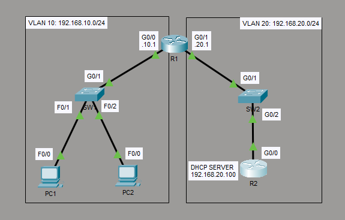
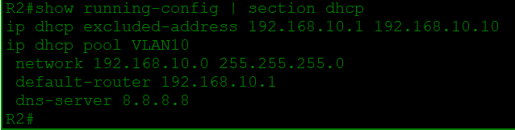
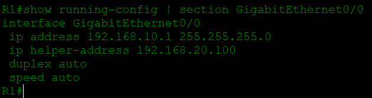
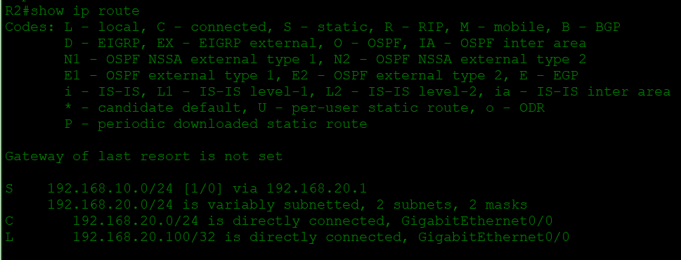
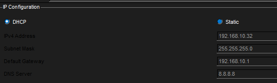
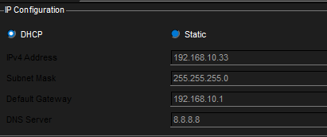
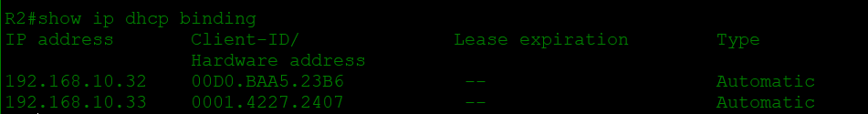
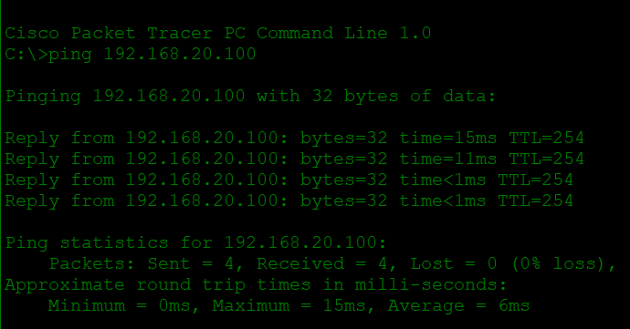

# 1.7 DHCPv4: client, server and relay on IOS

**CCNA v2.0 topic:** 1.7 Troubleshoot DHCPv4 client, server, and relay on IOS devices
**Lab:** DHCPv4 server on R2, DHCP relay on R1
**Test score:** __/10 (fill in after the test)
**Level:** can explain / can configure / can troubleshoot (update after the test)

> Verify important commands in Jeremy's IT Lab videos or Cisco docs. Lines marked "Packet Tracer only" are not exam facts.

---

## 1. The problem

Without DHCP you type the IP, mask, gateway and DNS on every device by hand. With many devices this takes days, and one typo gives two devices the same IP.

**DHCP** (Dynamic Host Configuration Protocol) gives these settings automatically:
- IP address and subnet mask
- Default gateway
- DNS server
- Lease time

---

## 2. DORA: how a client gets an address

```
 PC (no IP yet)                          DHCP server
      |                                        |
 D    |--- DISCOVER (broadcast) -------------->|  "Any DHCP server here?"
 O    |<-- OFFER ------------------------------|  "Take 192.168.10.11"
 R    |--- REQUEST (broadcast) --------------->|  "Yes, I want .11"
 A    |<-- ACK ---------------------------------|  "Confirmed. It is yours for the lease time"
```

| Fact | Value |
|---|---|
| Discover source IP | 0.0.0.0 (the PC has no IP yet) |
| Discover destination IP | 255.255.255.255 (broadcast) |
| Layer 2 broadcast MAC | FFFF.FFFF.FFFF |
| Server port | UDP 67 |
| Client port | UDP 68 |

- The Offer is only an offer. The address is really the client's only after the **ACK**.
- Windows PC with no answer: shows **169.254.x.x** (APIPA). It means the Discover was sent but **no Offer came back**.
- A Cisco router with no answer: the interface simply has no address.

---

## 3. Lease and renewal

An address is **rented**, not owned. Without a lease, addresses of devices that left would stay used forever and the pool would run out.

```
 Lease start                50%                     87.5%             100%
     |------------------------|------------------------|----------------|
     ACK                      T1                       T2             expires
                     client asks the SAME       client broadcasts to      address
                     server to extend           ANY server                is lost
```

- Lease time is chosen by the admin. Short for guest Wi-Fi, long for fixed office PCs.
- Default lease on IOS: 1 day (check Cisco docs for your version).
- A client that renews at T1 normally keeps the same address.

---

## 4. DHCP server on a Cisco router

```
R2(config)# ip dhcp excluded-address 192.168.10.1 192.168.10.10
R2(config)# ip dhcp pool VLAN10
R2(dhcp-config)# network 192.168.10.0 255.255.255.0
R2(dhcp-config)# default-router 192.168.10.1
R2(dhcp-config)# dns-server 8.8.8.8
R2(dhcp-config)# lease 0 3 0
```

| Command | Meaning |
|---|---|
| `ip dhcp excluded-address A [B]` | Never give out these addresses. Global config mode |
| `ip dhcp pool NAME` | Create a pool. Prompt becomes `dhcp-config` |
| `network NET MASK` | Addresses to give out. Uses a **subnet mask**, not a wildcard |
| `default-router IP` | The gateway clients get |
| `dns-server IP` | The DNS server clients get |
| `lease DAYS HOURS MINUTES` | Lease time |

**Rules to remember**
- Do the **exclusion first**, then the pool. A pool starts giving addresses as soon as it exists.
- Exclude the router's own address and any static device (printer, server). The server cannot see static devices. Without exclusion you get **duplicate IPs**.
- The pool network must match the network of the interface the request arrives on (or the relay's giaddr). A pool for the wrong network gives no Offer.
- IOS DHCP service is on by default. `no service dhcp` turns it off.

**Packet Tracer only:** the `lease` command was not accepted on my router. Real IOS has it.

---

## 5. Why a relay is needed

A router **never forwards a broadcast**. If the DHCP server is in another network, the Discover stops at the router.

```
 VLAN 10: 192.168.10.0/24               VLAN 20: 192.168.20.0/24

 [PC1] ──Discover (broadcast)──> G0/0 [R1] G0/1 ──X  stops here   [R2 server]
```

Two ways to solve it:
1. One DHCP server in every network (many servers to manage).
2. One central server plus a **relay** on each router (one command per interface). Most companies use this.

---

## 6. DHCP relay: `ip helper-address`

The relay catches the broadcast and sends it as a **unicast** to the server.

```
 [PC1] ─1 Discover (broadcast)─> G0/0 [R1] G0/1 ─2 unicast─> [R2: 192.168.20.100]
                                  .10.1                         3 reads giaddr
 [PC1] <────────── 5 Offer ────── [R1] <──── 4 Offer ──────────┘
```

- R1 writes its own G0/0 address (192.168.10.1) into the message. This field is **giaddr** (gateway IP address).
- The server uses **giaddr to choose the pool**. So the server needs one pool for every client network it serves.
- The server also needs a **route back** to the client network, or the Offer never returns.

```
R1(config)# interface g0/0
R1(config-if)# ip helper-address 192.168.20.100
```

- Put it on the interface where the **client broadcast arrives** (facing the PCs), not facing the server.
- The IP is the **DHCP server's address**, not R1's own.
- `ip helper-address` also forwards some other UDP services by default (for example DNS and TFTP). Check Cisco docs for the full list.

---

## 7. Router as DHCP client

```
R1(config)# interface g0/1
R1(config-if)# ip address dhcp
R1(config-if)# no shutdown
```

- `ip address dhcp` makes the router a DHCP **client**, not a server.
- Check: `show ip interface brief`. The **Method** column shows `DHCP`. A hand-typed address shows `manual`.
- Status `administratively down` means the port needs `no shutdown`.

---

## 8. Show commands

| Command | Run on | Tells you |
|---|---|---|
| `show ip dhcp binding` | Server | IP to MAC list and lease info |
| `show ip dhcp pool` | Server | Pool size and used addresses |
| `show ip dhcp conflict` | Server | Addresses found already in use |
| `show ip dhcp server statistics` | Server | Counters for Discover, Offer, Request, ACK (may not exist in Packet Tracer) |
| `show running-config \| section dhcp` | Router | Pool and exclusion lines |
| `show ip interface brief` | Router | Method column and port state |
| `show ip route` | Server | Is there a route back to the client network? |
| `debug ip dhcp server packet` | Server | Live DORA messages. Turn off with `undebug all` |
| `ipconfig /release` and `/renew` | Windows PC | Ask for a new address |

---

## 9. Troubleshooting flow

```
 PC has 169.254.x.x (or "DHCP request failed")
          │
          ▼
 1. Port up, right VLAN?            show ip interface brief / show vlan brief
          ▼
 2. Same network as the server?
      ├─ yes ─> go to 4
      └─ no  ─> 3. Relay on the PC-facing interface? Correct server IP?
          ▼
 4. Pool for that network? Mask right? default-router present?
          ▼
 5. Pool full? Everything excluded? Conflicts?   show ip dhcp pool / conflict
          ▼
 6. Does the server have a route back?           show ip route
```

Counter pattern:
- Discover = 0 on the server: nothing arrives. Check the VLAN, cable, helper-address.
- Discover goes up but Offer = 0: check the pool (wrong network, full, all excluded).
- Offer goes up but the PC gets nothing: check the return route.

---

## 10. My lab

**Lab name:** Lab 1.7 DHCPv4 server on R2 with relay on R1

```
 VLAN 10: 192.168.10.0/24            VLAN 20: 192.168.20.0/24

 [PC1] [PC2]                              [R2 = DHCP server]
    \   /                                   192.168.20.100
  [SW1]                                          │
      │                                       [SW2]
   G0/0 .10.1 ──[ R1 ]── G0/1 .20.1 ───────────┘
```

| Device | Port | IP |
|---|---|---|
| R1 | G0/0 | 192.168.10.1/24 |
| R1 | G0/1 | 192.168.20.1/24 |
| R2 | G0/0 | 192.168.20.100/24 |
| PC1, PC2 | Fa0 | DHCP |

**What I configured**
- R2: exclusion `.1` to `.10`, pool VLAN10, static route back to 192.168.10.0/24 via 192.168.20.1
- R1: `ip helper-address 192.168.20.100` on G0/0

**Result**
- PC1 got 192.168.10.32, PC2 got 192.168.10.33
- Both got gateway 192.168.10.1 and DNS 8.8.8.8
- `show ip dhcp binding` on R2 lists both MAC addresses
- PC1 can ping 192.168.20.100










Configs: [R1](configs/R1-config.txt), [R2](configs/R2-config.txt)

**The fault I found:** the relay and the pool were right, but PC1 still showed "DHCP request failed". `show ip route` on R2 had only `C` and `L` lines and no route to 192.168.10.0/24. The Offer had no way back. I added a static route (`S`) and it worked.

Route codes: `C` connected network, `L` the router's own address (/32), `S` static route typed by hand.

---

## 11. Common mistakes

- "The Discover source is broadcast." No. The source is 0.0.0.0. The **destination** is broadcast.
- "The DHCP server avoids addresses already in use." No. It does not know static devices. You must exclude them.
- "`network` in a DHCP pool uses a wildcard mask." No. It uses a subnet mask.
- "The helper-address goes toward the server." No. It goes on the interface facing the clients.
- "`ip address dhcp` makes a router a DHCP server." No. It makes it a client.
- "No IP on the PC means the server is broken." Often the fault is on the path (VLAN, helper, return route).
- DHCP is not DSCP. DSCP is QoS.

---

## 12. Must memorize

| Fact | Value |
|---|---|
| DORA | Discover, Offer, Request, ACK |
| Ports | Server UDP 67, client UDP 68 |
| Discover | Source 0.0.0.0, destination 255.255.255.255 |
| Renewal | T1 at 50%, T2 at 87.5% |
| Pool network | `network NET SUBNET-MASK` |
| Exclusion | `ip dhcp excluded-address FIRST [LAST]`, do it first |
| Lease format | `lease DAYS HOURS MINUTES` |
| Relay | `ip helper-address SERVER-IP` on the client-facing interface |
| Pool choice | Server picks the pool by giaddr |
| Router as client | `ip address dhcp` + `no shutdown` |
| Check | `show ip dhcp binding`, `show ip dhcp pool`, `show ip dhcp conflict` |
| 169.254.x.x | Windows APIPA: no Offer came back |

---

## 13. Packet Tracer limits (not exam facts)

- `lease` was not accepted in the DHCP pool on my router.
- `show running-config interface g0/0` was not accepted. I used `show running-config | section GigabitEthernet0/0`.
- Lease expiration showed `--` in `show ip dhcp binding`.
- First address given was .32, not .11. I do not know why. It was inside the pool.
